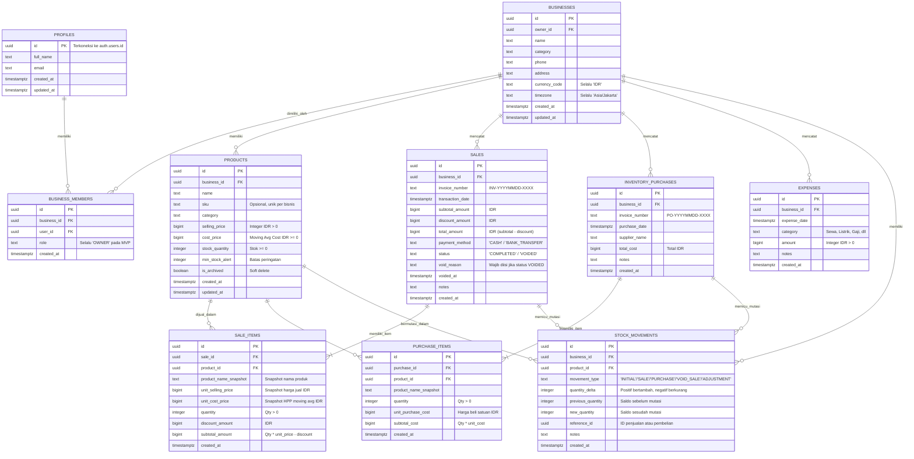

# VeyraOS --- PostgreSQL Database Schema Specification

**Versi:** 1.0  
**Status:** Usulan Desain Skema (Phase 3 Database Architecture Baseline - UNEXECUTED PROPOSAL)  
**Produk:** VeyraOS  
**DBMS Target:** PostgreSQL 15+ (Supabase)  
**Standar Keuangan:** Semua nilai moneter menggunakan `BIGINT` (Rupiah utuh, tanpa sen, tanpa floating-point)  

---

## 1. Diagram Relasi Entitas (Entity-Relationship Diagram)



---

## 2. Definisi Skema DDL Lengkap (PostgreSQL Proposed DDL)

> **Pemberitahuan:** Seluruh kode DDL di bawah ini adalah usulan spesifikasi teknis dan **belum dieksekusi** di lingkungan basis data mana pun.

```sql
-- ============================================================================
-- 1. EXTENSIONS & SETUP
-- ============================================================================
CREATE EXTENSION IF NOT EXISTS "uuid-ossp";

-- ============================================================================
-- 2. TABEL PROFILES (Terhubung ke Supabase Auth)
-- ============================================================================
CREATE TABLE profiles (
    id UUID PRIMARY KEY REFERENCES auth.users(id) ON DELETE CASCADE,
    full_name TEXT NOT NULL,
    email TEXT NOT NULL,
    created_at TIMESTAMPTZ NOT NULL DEFAULT timezone('utc'::text, now()),
    updated_at TIMESTAMPTZ NOT NULL DEFAULT timezone('utc'::text, now())
);

-- ============================================================================
-- 3. TABEL BUSINESSES & BUSINESS_MEMBERS (Multi-Tenant Isolation)
-- ============================================================================
CREATE TABLE businesses (
    id UUID PRIMARY KEY DEFAULT uuid_generate_v4(),
    owner_id UUID NOT NULL REFERENCES profiles(id) ON DELETE CASCADE,
    name TEXT NOT NULL CHECK (char_length(trim(name)) >= 2),
    category TEXT,
    phone TEXT,
    address TEXT,
    currency_code VARCHAR(3) NOT NULL DEFAULT 'IDR',
    timezone TEXT NOT NULL DEFAULT 'Asia/Jakarta',
    created_at TIMESTAMPTZ NOT NULL DEFAULT timezone('utc'::text, now()),
    updated_at TIMESTAMPTZ NOT NULL DEFAULT timezone('utc'::text, now())
);

CREATE TABLE business_members (
    id UUID PRIMARY KEY DEFAULT uuid_generate_v4(),
    business_id UUID NOT NULL REFERENCES businesses(id) ON DELETE CASCADE,
    user_id UUID NOT NULL REFERENCES profiles(id) ON DELETE CASCADE,
    role VARCHAR(20) NOT NULL DEFAULT 'OWNER' CHECK (role IN ('OWNER')),
    created_at TIMESTAMPTZ NOT NULL DEFAULT timezone('utc'::text, now()),
    CONSTRAINT uq_business_member UNIQUE (business_id, user_id)
);

CREATE INDEX idx_businesses_owner ON businesses(owner_id);
CREATE INDEX idx_business_members_user ON business_members(user_id, business_id);

-- ============================================================================
-- 4. TABEL PRODUCTS & STOCK MOVEMENTS
-- ============================================================================
CREATE TABLE products (
    id UUID PRIMARY KEY DEFAULT uuid_generate_v4(),
    business_id UUID NOT NULL REFERENCES businesses(id) ON DELETE CASCADE,
    name TEXT NOT NULL CHECK (char_length(trim(name)) >= 1),
    sku TEXT,
    category TEXT,
    selling_price BIGINT NOT NULL CHECK (selling_price > 0),
    cost_price BIGINT NOT NULL DEFAULT 0 CHECK (cost_price >= 0),
    stock_quantity INTEGER NOT NULL DEFAULT 0 CHECK (stock_quantity >= 0),
    min_stock_alert INTEGER NOT NULL DEFAULT 5 CHECK (min_stock_alert >= 0),
    is_archived BOOLEAN NOT NULL DEFAULT FALSE,
    created_at TIMESTAMPTZ NOT NULL DEFAULT timezone('utc'::text, now()),
    updated_at TIMESTAMPTZ NOT NULL DEFAULT timezone('utc'::text, now()),
    CONSTRAINT uq_products_business_id UNIQUE (business_id, id)
);

-- SKU unik per bisnis (hanya jika SKU diisi dan tidak null)
CREATE UNIQUE INDEX uq_products_sku_per_business 
ON products(business_id, sku) 
WHERE sku IS NOT NULL AND sku <> '' AND is_archived = FALSE;

CREATE INDEX idx_products_business ON products(business_id) WHERE is_archived = FALSE;
CREATE INDEX idx_products_stock ON products(business_id, stock_quantity);

CREATE TABLE stock_movements (
    id UUID PRIMARY KEY DEFAULT uuid_generate_v4(),
    business_id UUID NOT NULL REFERENCES businesses(id) ON DELETE CASCADE,
    product_id UUID NOT NULL REFERENCES products(id) ON DELETE RESTRICT,
    movement_type VARCHAR(30) NOT NULL CHECK (movement_type IN ('INITIAL', 'SALE', 'PURCHASE', 'VOID_SALE', 'ADJUSTMENT')),
    quantity_delta INTEGER NOT NULL CHECK (quantity_delta <> 0),
    previous_quantity INTEGER NOT NULL CHECK (previous_quantity >= 0),
    new_quantity INTEGER NOT NULL CHECK (new_quantity >= 0),
    reference_id UUID,
    notes TEXT,
    created_at TIMESTAMPTZ NOT NULL DEFAULT timezone('utc'::text, now())
);

CREATE INDEX idx_stock_movements_product ON stock_movements(product_id, created_at DESC);
CREATE INDEX idx_stock_movements_business ON stock_movements(business_id, created_at DESC);

-- ============================================================================
-- 5. TABEL SALES & SALE_ITEMS (Preserving Immutable Snapshots & Tenant Isolation)
-- ============================================================================
CREATE TABLE sales (
    id UUID PRIMARY KEY DEFAULT uuid_generate_v4(),
    business_id UUID NOT NULL REFERENCES businesses(id) ON DELETE CASCADE,
    invoice_number VARCHAR(50) NOT NULL,
    transaction_date TIMESTAMPTZ NOT NULL DEFAULT timezone('utc'::text, now()),
    subtotal_amount BIGINT NOT NULL CHECK (subtotal_amount >= 0),
    discount_amount BIGINT NOT NULL DEFAULT 0 CHECK (discount_amount >= 0),
    total_amount BIGINT NOT NULL CHECK (total_amount >= 0),
    payment_method VARCHAR(20) NOT NULL CHECK (payment_method IN ('CASH', 'BANK_TRANSFER')),
    status VARCHAR(20) NOT NULL DEFAULT 'COMPLETED' CHECK (status IN ('COMPLETED', 'VOIDED')),
    void_reason TEXT,
    voided_at TIMESTAMPTZ,
    notes TEXT,
    created_at TIMESTAMPTZ NOT NULL DEFAULT timezone('utc'::text, now()),
    CONSTRAINT uq_sales_invoice UNIQUE (business_id, invoice_number)
);

CREATE INDEX idx_sales_business_date ON sales(business_id, transaction_date DESC);
CREATE INDEX idx_sales_status ON sales(business_id, status);

CREATE TABLE sale_items (
    id UUID PRIMARY KEY DEFAULT uuid_generate_v4(),
    sale_id UUID NOT NULL REFERENCES sales(id) ON DELETE CASCADE,
    business_id UUID NOT NULL REFERENCES businesses(id) ON DELETE CASCADE,
    product_id UUID NOT NULL,
    product_name_snapshot TEXT NOT NULL,
    unit_selling_price BIGINT NOT NULL CHECK (unit_selling_price >= 0),
    unit_cost_price BIGINT NOT NULL CHECK (unit_cost_price >= 0),
    quantity INTEGER NOT NULL CHECK (quantity > 0),
    discount_amount BIGINT NOT NULL DEFAULT 0 CHECK (discount_amount >= 0),
    subtotal_amount BIGINT NOT NULL CHECK (subtotal_amount >= 0),
    created_at TIMESTAMPTZ NOT NULL DEFAULT timezone('utc'::text, now()),
    -- Jaminan Mutlak Anti Cross-Tenant Reference:
    CONSTRAINT fk_sale_items_product_same_tenant
        FOREIGN KEY (business_id, product_id)
        REFERENCES products(business_id, id) ON DELETE RESTRICT
);

CREATE INDEX idx_sale_items_sale ON sale_items(sale_id);
CREATE INDEX idx_sale_items_business ON sale_items(business_id);
CREATE INDEX idx_sale_items_product ON sale_items(product_id);

-- ============================================================================
-- 6. TABEL INVENTORY_PURCHASES & PURCHASE_ITEMS
-- ============================================================================
CREATE TABLE inventory_purchases (
    id UUID PRIMARY KEY DEFAULT uuid_generate_v4(),
    business_id UUID NOT NULL REFERENCES businesses(id) ON DELETE CASCADE,
    invoice_number VARCHAR(50) NOT NULL,
    purchase_date TIMESTAMPTZ NOT NULL DEFAULT timezone('utc'::text, now()),
    supplier_name TEXT,
    total_cost BIGINT NOT NULL CHECK (total_cost >= 0),
    notes TEXT,
    created_at TIMESTAMPTZ NOT NULL DEFAULT timezone('utc'::text, now()),
    CONSTRAINT uq_purchases_invoice UNIQUE (business_id, invoice_number)
);

CREATE INDEX idx_purchases_business_date ON inventory_purchases(business_id, purchase_date DESC);

CREATE TABLE purchase_items (
    id UUID PRIMARY KEY DEFAULT uuid_generate_v4(),
    purchase_id UUID NOT NULL REFERENCES inventory_purchases(id) ON DELETE CASCADE,
    business_id UUID NOT NULL REFERENCES businesses(id) ON DELETE CASCADE,
    product_id UUID NOT NULL,
    product_name_snapshot TEXT NOT NULL,
    quantity INTEGER NOT NULL CHECK (quantity > 0),
    unit_purchase_cost BIGINT NOT NULL CHECK (unit_purchase_cost >= 0),
    subtotal_cost BIGINT NOT NULL CHECK (subtotal_cost >= 0),
    created_at TIMESTAMPTZ NOT NULL DEFAULT timezone('utc'::text, now()),
    -- Jaminan Mutlak Anti Cross-Tenant Reference:
    CONSTRAINT fk_purchase_items_product_same_tenant
        FOREIGN KEY (business_id, product_id)
        REFERENCES products(business_id, id) ON DELETE RESTRICT
);

CREATE INDEX idx_purchase_items_purchase ON purchase_items(purchase_id);
CREATE INDEX idx_purchase_items_business ON purchase_items(business_id);
CREATE INDEX idx_purchase_items_product ON purchase_items(product_id);

-- ============================================================================
-- 7. TABEL EXPENSES (Beban Operasional Terpisah)
-- ============================================================================
CREATE TABLE expenses (
    id UUID PRIMARY KEY DEFAULT uuid_generate_v4(),
    business_id UUID NOT NULL REFERENCES businesses(id) ON DELETE CASCADE,
    expense_date TIMESTAMPTZ NOT NULL DEFAULT timezone('utc'::text, now()),
    category VARCHAR(50) NOT NULL,
    amount BIGINT NOT NULL CHECK (amount > 0),
    notes TEXT,
    created_at TIMESTAMPTZ NOT NULL DEFAULT timezone('utc'::text, now())
);

CREATE INDEX idx_expenses_business_date ON expenses(business_id, expense_date DESC);
CREATE INDEX idx_expenses_category ON expenses(business_id, category);

-- ============================================================================
-- 8. TRIGGER: OTOMATIS TAMBAHKAN PEMBUAT BISNIS KE BUSINESS_MEMBERS
-- ============================================================================
CREATE OR REPLACE FUNCTION handle_new_business_owner()
RETURNS TRIGGER
LANGUAGE plpgsql
SECURITY DEFINER
SET search_path = public, auth
AS $$
BEGIN
    INSERT INTO public.business_members (business_id, user_id, role)
    VALUES (NEW.id, NEW.owner_id, 'OWNER');
    RETURN NEW;
END;
$$;

CREATE TRIGGER trg_after_business_insert
AFTER INSERT ON businesses
FOR EACH ROW
EXECUTE FUNCTION handle_new_business_owner();

-- ============================================================================
-- 9. STORED PROCEDURES TRANSAKSI ATOMIK (ACID Transactions via RPC)
-- ============================================================================

-- 9.1 PENCATATAN PENJUALAN ATOMIK DENGAN LOCK DETERMINISTIK & ALOKASI DISKON
CREATE OR REPLACE FUNCTION record_sale_transaction(
    p_business_id UUID,
    p_invoice_number TEXT,
    p_payment_method TEXT,
    p_discount_amount BIGINT,
    p_notes TEXT,
    p_items JSONB -- Array of {product_id, quantity, item_discount}
)
RETURNS JSONB
LANGUAGE plpgsql
SECURITY DEFINER
SET search_path = public, auth
AS $$
DECLARE
    v_sale_id UUID;
    v_subtotal BIGINT := 0;
    v_total BIGINT := 0;
    v_allocated_tx_discount BIGINT := 0;
    v_remaining_tx_discount BIGINT;
    v_item JSONB;
    v_prod RECORD;
    v_item_gross BIGINT;
    v_item_subtotal BIGINT;
    v_item_prop_discount BIGINT;
    v_total_items_subtotal BIGINT := 0;
    v_max_subtotal_item_id UUID;
    v_max_subtotal BIGINT := -1;
BEGIN
    -- 1. Verifikasi Hak Akses Tenant
    IF NOT is_business_member(p_business_id) THEN
        RAISE EXCEPTION 'UNAUTHORIZED_BUSINESS';
    END IF;

    IF jsonb_array_length(p_items) = 0 THEN
        RAISE EXCEPTION 'EMPTY_SALE_ITEMS';
    END IF;

    -- 2. Kunci Baris Produk Secara Deterministik (ORDER BY id ASC) untuk Mencegah Deadlock
    PERFORM id FROM products 
    WHERE business_id = p_business_id 
      AND id IN (SELECT (item->>'product_id')::UUID FROM jsonb_array_elements(p_items) AS item)
    ORDER BY id ASC
    FOR UPDATE;

    -- 3. Hitung Total Subtotal Awal untuk Keperluan Proporsi Diskon Terbanyak (Largest Remainder)
    FOR v_item IN SELECT * FROM jsonb_array_elements(p_items) LOOP
        SELECT id, selling_price, stock_quantity INTO v_prod
        FROM products WHERE id = (v_item->>'product_id')::UUID AND business_id = p_business_id;

        IF NOT FOUND THEN
            RAISE EXCEPTION 'PRODUCT_NOT_FOUND: %', (v_item->>'product_id');
        END IF;

        IF v_prod.stock_quantity < (v_item->>'quantity')::INTEGER THEN
            RAISE EXCEPTION 'STOCK_INSUFFICIENT: ID % sisa %, diminta %', 
                v_prod.id, v_prod.stock_quantity, (v_item->>'quantity')::INTEGER;
        END IF;

        v_item_gross := (v_item->>'quantity')::INTEGER * v_prod.selling_price;
        v_item_subtotal := v_item_gross - COALESCE((v_item->>'item_discount')::BIGINT, 0);
        v_total_items_subtotal := v_total_items_subtotal + v_item_subtotal;

        IF v_item_subtotal > v_max_subtotal THEN
            v_max_subtotal := v_item_subtotal;
            v_max_subtotal_item_id := v_prod.id;
        END IF;
    END LOOP;

    -- 4. Validasi Diskon Tidak Melebihi Subtotal
    p_discount_amount := LEAST(COALESCE(p_discount_amount, 0), v_total_items_subtotal);
    v_remaining_tx_discount := p_discount_amount;

    -- 5. Buat Header Penjualan
    INSERT INTO sales (
        business_id, invoice_number, subtotal_amount, discount_amount, 
        total_amount, payment_method, status, notes
    ) VALUES (
        p_business_id, p_invoice_number, v_total_items_subtotal, p_discount_amount, 
        v_total_items_subtotal - p_discount_amount, p_payment_method, 'COMPLETED', p_notes
    ) RETURNING id INTO v_sale_id;

    -- 6. Insert Items & Eksekusi Pemotongan Stok Atomik
    FOR v_item IN SELECT * FROM jsonb_array_elements(p_items) LOOP
        SELECT id, name, selling_price, cost_price, stock_quantity 
        INTO v_prod
        FROM products WHERE id = (v_item->>'product_id')::UUID AND business_id = p_business_id;

        v_item_gross := (v_item->>'quantity')::INTEGER * v_prod.selling_price;
        v_item_subtotal := v_item_gross - COALESCE((v_item->>'item_discount')::BIGINT, 0);

        -- Alokasi Diskon Transaksi (Largest Remainder Method)
        IF v_total_items_subtotal > 0 AND p_discount_amount > 0 THEN
            v_item_prop_discount := ROUND((p_discount_amount::NUMERIC * v_item_subtotal::NUMERIC) / v_total_items_subtotal::NUMERIC)::BIGINT;
            -- Tie-breaker: jika item dengan subtotal terbesar, tanggung selisih pembulatan
            IF v_prod.id = v_max_subtotal_item_id THEN
                v_item_prop_discount := v_remaining_tx_discount;
            ELSE
                v_item_prop_discount := LEAST(v_item_prop_discount, v_remaining_tx_discount);
                v_remaining_tx_discount := v_remaining_tx_discount - v_item_prop_discount;
            END IF;
        ELSE
            v_item_prop_discount := 0;
        END IF;

        -- Simpan Line Item dengan Snapshot Harga & HPP Abadi
        INSERT INTO sale_items (
            sale_id, business_id, product_id, product_name_snapshot,
            unit_selling_price, unit_cost_price, quantity, discount_amount, subtotal_amount
        ) VALUES (
            v_sale_id, p_business_id, v_prod.id, v_prod.name,
            v_prod.selling_price, v_prod.cost_price, (v_item->>'quantity')::INTEGER,
            COALESCE((v_item->>'item_discount')::BIGINT, 0) + v_item_prop_discount,
            v_item_subtotal - v_item_prop_discount
        );

        -- Potong Stok Fisik Produk
        UPDATE products 
        SET stock_quantity = stock_quantity - (v_item->>'quantity')::INTEGER,
            updated_at = now()
        WHERE id = v_prod.id;

        -- Catat Buku Besar Mutasi Stok
        INSERT INTO stock_movements (
            business_id, product_id, movement_type, quantity_delta,
            previous_quantity, new_quantity, reference_id
        ) VALUES (
            p_business_id, v_prod.id, 'SALE', -(v_item->>'quantity')::INTEGER,
            v_prod.stock_quantity, v_prod.stock_quantity - (v_item->>'quantity')::INTEGER, v_sale_id
        );
    END LOOP;

    RETURN jsonb_build_object(
        'sale_id', v_sale_id,
        'invoice_number', p_invoice_number,
        'subtotal_amount', v_total_items_subtotal,
        'discount_amount', p_discount_amount,
        'total_amount', v_total_items_subtotal - p_discount_amount
    );
END;
$$;

-- 9.2 PENCATATAN PEMBELIAN STOK RESTOCK ATOMIK (Moving Weighted Average Cost)
CREATE OR REPLACE FUNCTION record_purchase_transaction(
    p_business_id UUID,
    p_invoice_number TEXT,
    p_supplier_name TEXT,
    p_notes TEXT,
    p_items JSONB -- Array of {product_id, quantity, unit_purchase_cost}
)
RETURNS JSONB
LANGUAGE plpgsql
SECURITY DEFINER
SET search_path = public, auth
AS $$
DECLARE
    v_purchase_id UUID;
    v_total_cost BIGINT := 0;
    v_item JSONB;
    v_prod RECORD;
    v_qty INTEGER;
    v_cost BIGINT;
    v_item_subtotal BIGINT;
    v_new_avg_cost BIGINT;
BEGIN
    IF NOT is_business_member(p_business_id) THEN
        RAISE EXCEPTION 'UNAUTHORIZED_BUSINESS';
    END IF;

    -- Kunci baris produk secara ascending
    PERFORM id FROM products 
    WHERE business_id = p_business_id 
      AND id IN (SELECT (item->>'product_id')::UUID FROM jsonb_array_elements(p_items) AS item)
    ORDER BY id ASC
    FOR UPDATE;

    -- Hitung total biaya pembelian
    FOR v_item IN SELECT * FROM jsonb_array_elements(p_items) LOOP
        v_qty := (v_item->>'quantity')::INTEGER;
        v_cost := (v_item->>'unit_purchase_cost')::BIGINT;
        IF v_qty <= 0 OR v_cost < 0 THEN
            RAISE EXCEPTION 'INVALID_PURCHASE_VALUES';
        END IF;
        v_total_cost := v_total_cost + (v_qty * v_cost);
    END LOOP;

    -- Header Pembelian
    INSERT INTO inventory_purchases (
        business_id, invoice_number, supplier_name, total_cost, notes
    ) VALUES (
        p_business_id, p_invoice_number, p_supplier_name, v_total_cost, p_notes
    ) RETURNING id INTO v_purchase_id;

    -- Insert Items, Tambah Stok & Rekalkulasi Moving Average Cost
    FOR v_item IN SELECT * FROM jsonb_array_elements(p_items) LOOP
        v_qty := (v_item->>'quantity')::INTEGER;
        v_cost := (v_item->>'unit_purchase_cost')::BIGINT;
        v_item_subtotal := v_qty * v_cost;

        SELECT id, name, stock_quantity, cost_price INTO v_prod
        FROM products WHERE id = (v_item->>'product_id')::UUID AND business_id = p_business_id;

        -- Formula Baku Moving Weighted Average Cost (Integer Rounded)
        IF (v_prod.stock_quantity + v_qty) > 0 THEN
            v_new_avg_cost := ROUND(
                ((v_prod.stock_quantity::NUMERIC * v_prod.cost_price::NUMERIC) + (v_qty::NUMERIC * v_cost::NUMERIC))
                / (v_prod.stock_quantity + v_qty)::NUMERIC
            )::BIGINT;
        ELSE
            v_new_avg_cost := v_cost;
        END IF;

        INSERT INTO purchase_items (
            purchase_id, business_id, product_id, product_name_snapshot,
            quantity, unit_purchase_cost, subtotal_cost
        ) VALUES (
            v_purchase_id, p_business_id, v_prod.id, v_prod.name,
            v_qty, v_cost, v_item_subtotal
        );

        -- Perbarui Stok & Harga Pokok
        UPDATE products 
        SET stock_quantity = stock_quantity + v_qty,
            cost_price = v_new_avg_cost,
            updated_at = now()
        WHERE id = v_prod.id;

        -- Mutasi Stok Masuk
        INSERT INTO stock_movements (
            business_id, product_id, movement_type, quantity_delta,
            previous_quantity, new_quantity, reference_id
        ) VALUES (
            p_business_id, v_prod.id, 'PURCHASE', v_qty,
            v_prod.stock_quantity, v_prod.stock_quantity + v_qty, v_purchase_id
        );
    END LOOP;

    RETURN jsonb_build_object(
        'purchase_id', v_purchase_id,
        'invoice_number', p_invoice_number,
        'total_cost', v_total_cost
    );
END;
$$;

-- 9.3 PEMBATALAN PENJUALAN TOTAL ATOMIK (Full Sale Void with Restock)
CREATE OR REPLACE FUNCTION void_sale_transaction(
    p_business_id UUID,
    p_sale_id UUID,
    p_void_reason TEXT
)
RETURNS JSONB
LANGUAGE plpgsql
SECURITY DEFINER
SET search_path = public, auth
AS $$
DECLARE
    v_sale RECORD;
    v_item RECORD;
    v_prod RECORD;
BEGIN
    IF NOT is_business_member(p_business_id) THEN
        RAISE EXCEPTION 'UNAUTHORIZED_BUSINESS';
    END IF;

    IF length(trim(COALESCE(p_void_reason, ''))) < 5 THEN
        RAISE EXCEPTION 'INVALID_VOID_REASON: Alasan minimal 5 karakter';
    END IF;

    -- Kunci baris header penjualan
    SELECT * INTO v_sale FROM sales 
    WHERE id = p_sale_id AND business_id = p_business_id 
    FOR UPDATE;

    IF NOT FOUND THEN
        RAISE EXCEPTION 'SALE_NOT_FOUND';
    END IF;

    IF v_sale.status = 'VOIDED' THEN
        RAISE EXCEPTION 'SALE_ALREADY_VOIDED';
    END IF;

    -- Kunci produk-produk yang akan direturn dalam urutan ascending
    PERFORM id FROM products 
    WHERE business_id = p_business_id 
      AND id IN (SELECT product_id FROM sale_items WHERE sale_id = p_sale_id)
    ORDER BY id ASC
    FOR UPDATE;

    -- Update status penjualan menjadi VOIDED
    UPDATE sales 
    SET status = 'VOIDED',
        void_reason = p_void_reason,
        voided_at = now()
    WHERE id = p_sale_id;

    -- Balikkan stok fisik produk tepat 1 kali
    FOR v_item IN SELECT * FROM sale_items WHERE sale_id = p_sale_id LOOP
        SELECT id, stock_quantity INTO v_prod FROM products WHERE id = v_item.product_id;

        UPDATE products 
        SET stock_quantity = stock_quantity + v_item.quantity,
            updated_at = now()
        WHERE id = v_item.product_id;

        INSERT INTO stock_movements (
            business_id, product_id, movement_type, quantity_delta,
            previous_quantity, new_quantity, reference_id, notes
        ) VALUES (
            p_business_id, v_item.product_id, 'VOID_SALE', v_item.quantity,
            v_prod.stock_quantity, v_prod.stock_quantity + v_item.quantity, p_sale_id, p_void_reason
        );
    END LOOP;

    RETURN jsonb_build_object(
        'sale_id', p_sale_id,
        'status', 'VOIDED',
        'voided_at', now()
    );
END;
$$;
```

---

## 3. Justifikasi Tipe Data `BIGINT` untuk Uang Rupiah

1. **Jangkauan Nilai:** `BIGINT` (signed 64-bit integer) menampung nilai dari $-9.22 \times 10^{18}$ hingga $+9.22 \times 10^{18}$. Ini dapat menampung transaksi bisnis bernilai triliunan Rupiah tanpa risiko *integer overflow*.
2. **Eliminasi Cacat IEEE-754 Floating-Point:** Dalam JavaScript dan sistem basis data biner, angka pecahan floating-point mengalami ketidaktepatan presisi (misal: `0.1 + 0.2 = 0.30000000000000004`). Karena mata uang Rupiah Indonesia modern tidak menggunakan pecahan sen dalam pencatatan ritel sehari-hari, penyimpanan angka sebagai bilangan bulat Rupiah murni menjamin rekonsiliasi matematis $100\%$ presisi hingga selisih Rp 0.
3. **Integritas Penjumlahan:** Perhitungan agregat SQL (`SUM(total_amount)`, `SUM(unit_cost_price * quantity)`) berjalan sangat cepat pada CPU level integer tanpa konversi desimal lambat.
