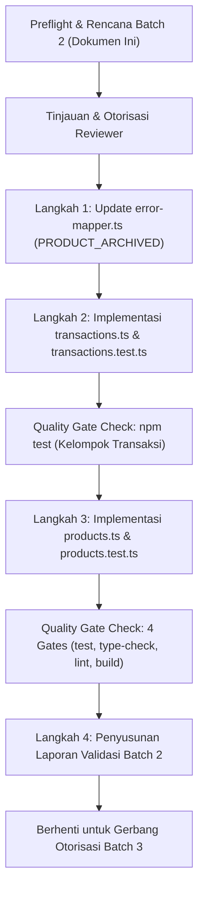

# VeyraOS — Preflight & Architecture Plan: Stage 3.3 (Batch 2)
## Server Actions Transaksi POS & Persediaan / Katalog Produk

**Proyek:** VeyraOS  
**Fase:** Phase 4 — Application & Service Integration Layer  
**Substage:** Stage 3.3 — Next.js Server Actions & Tenant Context Application Layer  
**Batch:** **Batch 2 (Transaksi POS & Persediaan / Katalog Produk)**  
**Status Dokumen:** **PROPOSED — STOPPED FOR REVIEWER AUTHORIZATION**  
**Tanggal:** 14 Oktober 2026  
**Auditor / Implementer:** Lead Full-Stack Architect & Security Engineer  

---

## 1. Status Awal & Konteks Eksekusi

1. **Penyelesaian Batch 1:**
   - Server Actions autentikasi (`auth.ts`) dan preferensi tenant (`business.ts`) telah selesai diimplementasikan dan diaudit.
   - Remediasi temuan `SEC-3.3-02` (semantik indikator konfirmasi email Supabase GoTrue) telah diverifikasi penuh dengan 6 skenario uji spesifik.
   - Seluruh **347 unit tests lulus 100%** (16 berkas pengujian).
   - Seluruh 4 Quality Gates (`test`, `type-check`, `lint`, `build`) berstatus **PASS** (0 errors, 0 warnings, build Next.js 16.4 Turbopack sukses).
2. **Batasan Pengujian:**
   - Seluruh pengujian saat ini menggunakan mock terisolasi (Level 1 Unit Test).
   - Pengujian ini **belum membuktikan** integrasi runtime PostgreSQL fisik, row-locking live, atau penegakan RLS kernel di database Supabase live.
3. **Kepatuhan Batasan Proyek:**
   - **TIDAK ADA mutasi langsung pada database Supabase live.**
   - **TIDAK ADA Git commit.**
   - **TIDAK ADA pembuatan kode UI** atau fitur di luar cakupan Batch 2.
   - **Batch 3 (Beban Operasional & Laporan) dan Batch 4 (Audit Penutupan) BELUM DIMULAI.**

---

## 2. Pemeriksaan Temuan Katalog Produk Terbuka (ACT-3.2.2A-01)

### 2.1 Analisis Masalah Produk Terarsip pada RPC Penjualan
- **Latar Belakang:** Pada audit penutupan Substage 3.2.2A ([`docs/stage-3.2.2A-final-closure.md`](file:///c:/Antigravity%20Project/VeyraOS/docs/stage-3.2.2A-final-closure.md)), teridentifikasi temuan P2 `ACT-3.2.2A-01`:
  - Lapisan service `getProductsForTransaction` telah memfilter `is_archived = false` sehingga produk arsip tidak muncul di antarmuka kasir.
  - Namun, pada level database PostgreSQL, Stored Procedure `record_sale_transaction` (baik pada migrasi `009`, `010`, maupun `011`) hanya memvalidasi keberadaan produk (`PRODUCT_NOT_FOUND`) dan ketersediaan stok (`STOCK_INSUFFICIENT`), tetapi **belum memeriksa flag `is_archived`**.
  - Jika klien yang dimanipulasi mengirimkan `product_id` dari produk yang sudah diarsipkan, transaksi penjualan akan tetap diproses oleh database.
- **Prinsip Defense-in-Depth:** Penolakan produk yang telah diarsipkan wajib ditegakkan di dua lapisan:
  1. **Layer Aplikasi (Service & Server Actions):** Memvalidasi status aktif produk sebelum eksekusi.
  2. **Layer Database (Stored Procedure RPC):** Menolak secara atomik dengan `RAISE EXCEPTION 'PRODUCT_ARCHIVED: ...'`.

### 2.2 Usulan Migrasi Forward-Only (Unexecuted Review Artifact)
Sesuai batasan preflight, **dilarang mengubah berkas migrasi lama** (`009`, `010`, `011`). Sebagai gantinya, sebuah proposal migrasi forward-only terpisah telah disiapkan:
- **Berkas Proposal:** [`supabase/migrations/20261014000012_reject_archived_products_in_sales.sql`](file:///c:/Antigravity%20Project/VeyraOS/supabase/migrations/20261014000012_reject_archived_products_in_sales.sql)
- **Status:** **PROPOSAL / UNEXECUTED (ARTEFAK TERTINJAU — BELUM DIEKSEKUSI DI LIVE DB)**.
- **Klausul SQL Tambahan pada Pass 1 & Pass 2 `record_sale_transaction`:**
  ```sql
  IF v_prod.is_archived THEN
      RAISE EXCEPTION 'PRODUCT_ARCHIVED: Produk "%" telah diarsipkan dan tidak dapat dijual', v_prod.name;
  END IF;
  ```
- **Pemetaan Error Domain pada [`src/services/transactions/error-mapper.ts`](file:///c:/Antigravity%20Project/VeyraOS/src/services/transactions/error-mapper.ts):**
  ```typescript
  if (message.includes("PRODUCT_ARCHIVED")) {
    return {
      success: false,
      error: {
        code: "PRODUCT_ARCHIVED",
        message: message.replace(/^PRODUCT_ARCHIVED:\s*/, "") || "Produk telah diarsipkan dan tidak dapat dijual",
      },
    };
  }
  ```

---

## 3. Cakupan Kerja & Rencana Desain Batch 2

Batch 2 dibatasi secara ketat pada **Domain Transaksi POS & Persediaan** serta **Domain Katalog Produk & Master Stok**.

### 3.1 Berkas yang Akan Dibuat & Diubah

| Berkas | Aksi | Peran & Deskripsi |
|---|---|---|
| [`supabase/migrations/20261014000012_reject_archived_products_in_sales.sql`](file:///c:/Antigravity%20Project/VeyraOS/supabase/migrations/20261014000012_reject_archived_products_in_sales.sql) | **Dibuat (Proposal)** | Artefak migrasi forward-only unexecuted untuk penolakan produk arsip di RPC database. |
| [`src/services/transactions/error-mapper.ts`](file:///c:/Antigravity%20Project/VeyraOS/src/services/transactions/error-mapper.ts) | **Diubah** | Menambahkan penanganan dan pemetaan error eksplisit untuk kode `PRODUCT_ARCHIVED`. |
| [`src/app/actions/transactions.ts`](file:///c:/Antigravity%20Project/VeyraOS/src/app/actions/transactions.ts) | **Dibuat Baru** | Next.js Server Actions untuk transaksi kasir POS, restock, pembatalan void, dan query item kasir. |
| [`src/app/actions/transactions.test.ts`](file:///c:/Antigravity%20Project/VeyraOS/src/app/actions/transactions.test.ts) | **Dibuat Baru** | Unit test suite mock komprehensif untuk transaksi POS (minimal 10 skenario). |
| [`src/app/actions/products.ts`](file:///c:/Antigravity%20Project/VeyraOS/src/app/actions/products.ts) | **Dibuat Baru** | Next.js Server Actions untuk katalog produk, filter pencarian, update metadata, dan soft-delete arsip. |
| [`src/app/actions/products.test.ts`](file:///c:/Antigravity%20Project/VeyraOS/src/app/actions/products.test.ts) | **Dibuat Baru** | Unit test suite mock komprehensif untuk katalog produk (minimal 10 skenario). |
| [`docs/stage-3.3-batch-2-preflight-report.md`](file:///c:/Antigravity%20Project/VeyraOS/docs/stage-3.3-batch-2-preflight-report.md) | **Dibuat Baru** | Dokumen preflight, rencana arsitektur, dan gerbang otorisasi Batch 2 ini. |

---

## 4. Desain Kontrak & Pola Resolusi Tenant

### 4.1 Pola Resolusi Tenant Context (Defense-in-Depth & Fail-Closed)
Untuk seluruh Server Actions pada Batch 2:
1. **Prioritas Input Klien (`businessId`):**
   - Jika klien menyertakan `businessId`, format divalidasi ketat menggunakan `uuidSchema`. Jika tidak valid, aksi menolak dengan `VALIDATION_ERROR`.
   - Klien **TIDAK PERNAH** dipercayai secara buta. Nilai `businessId` divalidasi keanggotaannya oleh service layer melalui `verifyUserAndBusinessMembership(supabase, businessId)`.
2. **Fallback ke Preferensi Cookie Aktif (`veyra_active_business_id`):**
   - Jika klien tidak menyertakan `businessId` (`undefined` / kosong), Server Action membaca nilai preferensi aktif dari cookie via `await cookies()`.
   - Jika cookie berisi UUID valid, gunakan UUID tersebut sebagai `businessId` target dan validasi keanggotaan di service layer.
   - Jika cookie tidak ada/kosong, selesaikan bisnis default pengguna via `resolveTenantContext()` secara deterministik (`created_at ASC, id ASC`).
   - Jika pengguna memiliki 0 bisnis atau tidak terotorisasi, tolak seketika dengan `UNAUTHORIZED_BUSINESS` atau `ACTIVE_BUSINESS_REQUIRED`.
   - **Prinsip Anti-Silent Fallback:** Jika cookie ada tapi rusak/bukan anggota, tolak langsung dan bersihkan cookie; **DILARANG** diam-diam beralih ke bisnis lain.

### 4.2 Kontrak Server Actions: `src/app/actions/transactions.ts`
```typescript
"use server";

import type {
  ApiResponse,
  RecordSaleInput,
  SaleReceiptResponse,
  RecordPurchaseInput,
  PurchaseReceiptResponse,
  VoidSaleInput,
  VoidSaleResponse,
  ProductItemResponse,
} from "@/types/api";

// 1. Mencatat Transaksi Penjualan Kasir POS (Penerbitan Faktur CSPRNG di Service)
export async function createSaleAction(
  input: Omit<RecordSaleInput, "businessId"> & { businessId?: string }
): Promise<ApiResponse<SaleReceiptResponse>>;

// 2. Mencatat Transaksi Pembelian Persediaan (Restock Faktur PO di Service)
export async function recordPurchaseAction(
  input: Omit<RecordPurchaseInput, "businessId"> & { businessId?: string }
): Promise<ApiResponse<PurchaseReceiptResponse>>;

// 3. Membatalkan Transaksi Penjualan (Void Sale dengan Alasan Minimum 5 Karakter)
export async function voidSaleAction(
  input: Omit<VoidSaleInput, "businessId"> & { businessId?: string }
): Promise<ApiResponse<VoidSaleResponse>>;

// 4. Membaca Produk Aktif untuk Antarmuka Kasir POS
export async function getProductsForTransactionAction(
  businessId?: string,
  query?: string
): Promise<ApiResponse<ProductItemResponse[]>>;
```

### 4.3 Kontrak Server Actions: `src/app/actions/products.ts`
```typescript
"use server";

import type {
  ApiResponse,
  CreateProductInput,
  UpdateProductInput,
  GetProductsQuery,
  ProductItemResponse,
} from "@/types/api";

// 1. Membuat Produk Baru (Hanya mengizinkan stok awal = 0)
export async function createProductAction(
  input: Omit<CreateProductInput, "businessId"> & { businessId?: string }
): Promise<ApiResponse<ProductItemResponse>>;

// 2. Membaca Daftar Katalog Produk dengan Filter (Kategori, Query, Low Stock, Arsip)
export async function getProductsAction(
  query?: Omit<GetProductsQuery, "businessId"> & { businessId?: string }
): Promise<ApiResponse<ProductItemResponse[]>>;

// 3. Mengambil Detail Satu Produk Berdasarkan ID
export async function getProductByIdAction(
  id: string,
  businessId?: string
): Promise<ApiResponse<ProductItemResponse>>;

// 4. Memperbarui Metadata Produk (DILARANG mengubah stok atau HPP secara langsung)
export async function updateProductAction(
  id: string,
  input: Omit<UpdateProductInput, "businessId"> & { businessId?: string }
): Promise<ApiResponse<ProductItemResponse>>;

// 5. Mengarsipkan Produk (Soft-delete: is_archived = true)
export async function archiveProductAction(
  id: string,
  businessId?: string
): Promise<ApiResponse<ProductItemResponse>>;
```

---

## 5. Rencana Pengujian Unit Mock (Target: $\ge 20$ Skenario Uji Baru)

### 5.1 Skenario Pengujian `src/app/actions/transactions.test.ts` (10 Skenario)
1. **Validasi Input POS:** Menolak payload penjualan dengan keranjang kosong (`EMPTY_ITEMS`), diskon negatif, atau metode pembayaran tidak valid (`VALIDATION_ERROR`).
2. **Penjualan Berhasil (Explicit `businessId`):** Berhasil mencatat penjualan saat `businessId` diberikan secara eksplisit dan valid.
3. **Penjualan Berhasil (Cookie Fallback):** Berhasil mencatat penjualan dengan membaca `businessId` aktif dari cookie `veyra_active_business_id`.
4. **Tenant Isolation / Otorisasi:** Menolak eksekusi penjualan jika pengguna bukan anggota bisnis (`UNAUTHORIZED_BUSINESS`).
5. **Mitigasi Insufficient Stock:** Menangani penolakan RPC database `STOCK_INSUFFICIENT` secara aman dan mengembalikan pesan informatif.
6. **Mitigasi Produk Terarsip:** Menangani penolakan RPC database `PRODUCT_ARCHIVED` secara aman.
7. **Pencatatan Pembelian (Restock):** Berhasil mencatat pembelian barang masuk dengan faktur PO dan pembaruan HPP MWAC.
8. **Validasi Alasan Void:** Menolak pembatalan transaksi jika alasan void kurang dari 5 karakter (`VALIDATION_ERROR` / `INVALID_VOID_REASON`).
9. **Void Transaksi Berhasil:** Berhasil mengeksekusi pembatalan transaksi penjualan yang sah.
10. **Ketiadaan Bisnis / Tenant Rusak:** Menolak transaksi jika pengguna tidak memiliki bisnis aktif (`ACTIVE_BUSINESS_REQUIRED`).

### 5.2 Skenario Pengujian `src/app/actions/products.test.ts` (10 Skenario)
1. **Validasi Pembuatan Produk:** Menolak data produk dengan nama kosong atau harga jual $< 0$ (`VALIDATION_ERROR`).
2. **Pembuatan Produk Berhasil (Stok 0):** Berhasil mendaftarkan produk baru dengan stok awal 0.
3. **Integritas Stok Awal Positif:** Menolak pembuatan produk dengan stok awal $> 0$ (`ATOMIC_INITIAL_STOCK_UNAVAILABLE`).
4. **Resolusi Tenant Produk:** Membaca `businessId` dari cookie aktif jika tidak disertakan dalam payload.
5. **Kueri Katalog & Filter:** Berhasil mengambil daftar produk dengan filter kategori dan pencarian kata kunci.
6. **Filter Stok Menipis:** Berhasil memfilter produk dengan kriteria stok menipis (`lowStockOnly`).
7. **Integritas Mutasi Metadata Produk:** Berhasil memperbarui nama, kategori, atau harga jual produk.
8. **Perlindungan Finansial (Forbidden Mutation):** Menolak pembaruan produk jika payload mencoba mengubah `stockQuantity` atau `costPrice` (`FORBIDDEN_FIELD_MUTATION`).
9. **Pengarsipan Produk (Soft-Delete):** Berhasil mengubah status produk menjadi `is_archived = true`.
10. **Tenant Boundary Violation:** Menolak pembacaan atau pembaruan produk dari tenant lain (`NOT_FOUND` / `UNAUTHORIZED_BUSINESS`).

---

## 6. Analisis Dependensi, Asumsi, dan Risiko

### 6.1 Dependensi Teknis
- **`@/services/transactions/transaction.service`:** Telah stabil dan teruji (18 unit tests).
- **`@/services/products/product.service`:** Telah stabil dan teruji (21 unit tests).
- **`@/services/business/business.service`:** Menyediakan `resolveTenantContext()` untuk penanganan fallback cookie.
- **`@/services/common/auth-guard`:** Memverifikasi sesi dan keanggotaan tenant di server.
- **`next/headers` (`cookies()`):** Pola async `await cookies()` Next.js 16.4.

### 6.2 Asumsi Arsitektur
- **Asumsi 1:** UI belum dirender pada tahap ini; tidak ada pemanggilan `revalidatePath` prematur.
- **Asumsi 2:** Nomor faktur kasir (`INV-YYYYMMDD-XXXXXX`) dan nomor PO (`PO-YYYYMMDD-XXXXXX`) dihasilkan secara server-authoritative oleh modul CSPRNG di service layer.
- **Asumsi 3:** Produk dengan stok awal positif tetap diarahkan melalui alur restock resmi (`recordPurchaseAction`).

### 6.3 Matriks Risiko & Mitigasi
| Risiko Potensial | Dampak | Mitigasi Ketat |
|---|---|---|
| **Penjualan Produk Terarsip** | Integritas Katalog | Filter `is_archived = false` di query kasir + penolakan `PRODUCT_ARCHIVED` di Stored Procedure 012 & error mapper. |
| **Bypass Tenant via Input** | Akses Lintas Tenant | Verifikasi keanggotaan bisnis wajib di server pada setiap pemanggilan service (Defense-in-Depth). |
| **Manipulasi Stok Tanpa Ledger** | Kerusakan Nilai Aset | Pemblokiran mutasi langsung `stockQuantity` pada `updateProductAction` (`FORBIDDEN_FIELD_MUTATION`). |
| **Ketiadaan Cookie / Bisnis** | Runtime Exception | Pengecekan fail-closed dengan resolusi deterministik via `resolveTenantContext()`. |

---

## 7. Urutan Substage Pelaksanaan Batch 2



---

## 8. Status Penghentian untuk Tinjauan Reviewer

Sesuai instruksi:
> *"Mulai dengan preflight dan rencana Batch 2. Jangan langsung mengimplementasikan seluruh Batch 2. Laporkan rencana, daftar file, risiko, dan urutan substage terlebih dahulu, lalu berhenti untuk ditinjau."*

```
================================================================================
                    GATE REVIEW STAGE 3.3 BATCH 2 (PREFLIGHT)
================================================================================
  Status Batch 1:   PASS (Remediasi SEC-3.3-02 Selesai, 347 Tests Lolos)
  Status Preflight: DIAJUKAN UNTUK REVIEW & OTORISASI
  Status Eksekusi:  STOPPED — MENUNGGU PERSETUJUAN REVIEWER
  Proposal DB:      20261014000012_reject_archived_products_in_sales.sql (Unexecuted)
  Tindakan:         Menunggu otorisasi untuk memulai Langkah 1 & 2
================================================================================
```
