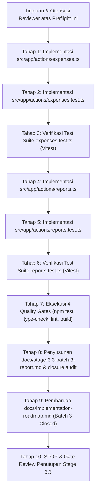

# VeyraOS — Preflight Report: Stage 3.3 Batch 3
## Operational Expense & Financial Reporting Server Actions (expenses.ts & reports.ts)

**Proyek:** VeyraOS  
**Fase:** Phase 4 — Application & Service Integration Layer  
**Tahap / Batch:** Stage 3.3 Batch 3 (Substage 2.5 Preflight)  
**Status Preflight:** **READY WITH CONDITIONS (AWAITING REVIEWER AUTHORIZATION)**  
**Tanggal:** 14 Oktober 2026  
**Auditor / Arsitek:** Principal Systems Architect & Lead Security Engineer  

---

## 1. Executive Summary

Laporan preflight ini disusun sebagai persiapan teknis formal sebelum pelaksanaan **Stage 3.3 Batch 3** berdasarkan dokumen otoritatif proyek VeyraOS ([`docs/implementation-roadmap.md`](file:///c:/Antigravity%20Project/VeyraOS/docs/implementation-roadmap.md), [`docs/stage-3.3-preflight-report.md`](file:///c:/Antigravity%20Project/VeyraOS/docs/stage-3.3-preflight-report.md), [`docs/stage-3.3-batch-2-report.md`](file:///c:/Antigravity%20Project/VeyraOS/docs/stage-3.3-batch-2-report.md), dan [`docs/stage-3.3-batch-2-closure-audit.md`](file:///c:/Antigravity%20Project/VeyraOS/docs/stage-3.3-batch-2-closure-audit.md)).

Batch 1 (Autentikasi & Preferensi Tenant) dan Batch 2 (Transaksi POS, Pembelian, & Katalog Produk) telah selesai diimplementasikan, diaudit, dan ditutup secara resmi dengan seluruh 4 Quality Gates lulus 100% (436 unit tests lulus).

**Ruang Lingkup Batch 3:**
Batch 3 berfokus pada implementasi lapisan Next.js Server Actions untuk:
1. **Pencatatan Beban Operasional (`src/app/actions/expenses.ts`)**: Pencatatan beban kas operasional independen, penolakan *hard-delete* destruktif (`DESTRUCTIVE_DELETION_FORBIDDEN`), dan pemisahan tegas dari persediaan barang.
2. **Dashboard & Analitik Finansial (`src/app/actions/reports.ts`)**: Agregasi KPI 6-kartu, laporan laba rugi, laporan beban per kategori, valuasi modal persediaan (MWAC), kalkulasi arus kas, serta ekspor CSV berstandar RFC 4180 dengan mitigasi Formula Injection (CWE-1236) dan header UTF-8 BOM.

### Batasan Ketat Preflight yang Ditaati:
- **Zero Code Modification:** Tidak ada berkas kode sumber aplikasi (`src/`) atau pengujian (`*.test.ts`) yang diubah pada tahap preflight ini.
- **Zero Database Mutation:** Database live Supabase tetap murni tanpa mutasi data atau eksekusi DDL.
- **Zero Migration Execution:** Tidak ada migrasi database yang dijalankan.
- **Zero Git Commit:** Tidak ada commit git yang dibuat.

---

## 2. Official Roadmap Scope

Berdasarkan penelusuran terhadap dokumen roadmap resmi proyek:

1. **[`docs/implementation-roadmap.md#L110-L138`](file:///c:/Antigravity%20Project/VeyraOS/docs/implementation-roadmap.md#L110-L138):**
   - **Tahap 7:** Pencatatan Pengeluaran Operasional (Kategori bawaan, input nominal Rupiah integer, pencegahan pencatatan stok di pengeluaran, isolasi multi-tenant).
   - **Tahap 8:** Dashboard Bisnis & Laporan Finansial (Dashboard KPI 6-kartu, Laba Rugi Sederhana: Omzet, HPP, Laba Kotor, Laba Operasional, Arus Kas Masuk/Keluar, Filter rentang tanggal terstandarisasi waktu `Asia/Jakarta`).
   - **Tahap 9:** Ekspor CSV (Format RFC 4180, mitigasi Formula Injection CWE-1236, UTF-8 BOM).

2. **[`docs/stage-3.3-preflight-report.md#L132-L156`](file:///c:/Antigravity%20Project/VeyraOS/docs/stage-3.3-preflight-report.md#L132-L156):**
   - Mendefinisikan kontrak Server Actions untuk Batch 3:
     - `expenses.ts`: `recordExpenseAction`, `getExpensesAction`, `getExpenseByIdAction`, `updateExpenseAction`, `deleteExpenseAction`.
     - `reports.ts`: `getDashboardSummaryAction`, `getSalesReportAction`, `getExpenseReportAction`, `getStockReportAction`, `exportReportCsvAction`.

3. **Tujuan Resmi Batch 3:**
   - Menyediakan antarmuka Server Actions yang aman, server-authoritative, dan tervalidasi Zod untuk seluruh operasi beban operasional dan pelaporan finansial.
   - Mengonsolidasikan resolusi tenant melalui modul bersama `src/lib/constants/tenant-cookie.ts` yang telah diekstraksi pada Substage 2.4.
   - Menghilangkan celah Dependency Injection publik (pola SEC-3.3-05).
   - Memastikan seluruh invarian matematis finansial VeyraOS terjaga tanpa distorsi pembulatan atau pergeseran zona waktu.

---

## 3. Existing Implementation Inventory

Seluruh fondasi service layer, validasi, dan helper utilitas untuk Batch 3 telah siap dan teruji pada fase sebelumnya:

### 3.1 Service Layer (`src/services/`)
- [`src/services/expenses/expense.service.ts`](file:///c:/Antigravity%20Project/VeyraOS/src/services/expenses/expense.service.ts):
  - `recordExpense`: Mencatat pengeluaran operasional Rupiah positif.
  - `getExpenses`: Query riwayat beban dengan filter rentang tanggal dan kategori.
  - `getExpenseById`: Detail beban dengan isolasi tenant wajib (`business_id`).
  - `updateExpense`: Pembaruan administratif metadata/nominal beban.
  - `deleteExpense`: Menolak penghapusan fisik destruktif demi integritas jejak audit (`DESTRUCTIVE_DELETION_FORBIDDEN`).
- [`src/services/reports/report.service.ts`](file:///c:/Antigravity%20Project/VeyraOS/src/services/reports/report.service.ts):
  - `getDashboardSummary`: Agregasi 6 kartu KPI, tren penjualan Jakarta WIB, 5 transaksi terbaru, dan peringatan stok.
  - `getSalesReport`: Laporan omzet penjualan dengan paginasi eksplisit dan ringkasan summary matematis.
  - `getExpenseReport`: Agregasi beban operasional per kategori dan persentase.
  - `getStockReport`: Laporan valuasi modal stok (MWAC) dan potensi omzet.
  - `exportReportCsv`: Pembuatan berkas CSV RFC 4180 dengan UTF-8 BOM dan sanitasi CWE-1236.
- [`src/services/common/auth-guard.ts`](file:///c:/Antigravity%20Project/VeyraOS/src/services/common/auth-guard.ts):
  - `verifyUserAndBusinessMembership`: Autentikasi sesi dan otorisasi keanggotaan bisnis di sisi server.
- [`src/services/transactions/error-mapper.ts`](file:///c:/Antigravity%20Project/VeyraOS/src/services/transactions/error-mapper.ts):
  - Pemetaan error PostgreSQL / PostgREST / Zod ke amplop `ApiResponse<T>`.

### 3.2 Library & Utilitas (`src/lib/`)
- [`src/lib/constants/tenant-cookie.ts`](file:///c:/Antigravity%20Project/VeyraOS/src/lib/constants/tenant-cookie.ts):
  - Konstanta terpadu `TENANT_COOKIE_NAME` dan `TENANT_COOKIE_OPTIONS` (HttpOnly, SameSite=Lax, Path=/, MaxAge=30d).
- [`src/lib/financial.ts`](file:///c:/Antigravity%20Project/VeyraOS/src/lib/financial.ts):
  - Kalkulasi laba kotor, margin laba kotor, laba operasional, arus kas bersih.
  - Penanganan batas waktu setengah terbuka `[startUtc, nextDayUtc)` Asia/Jakarta (UTC+7).
  - Konversi aman `safeBigIntToNumber` dan `safeNumberToBigInt` dengan batas `MAX_SAFE_RUPIAH`.
- [`src/lib/csv.ts`](file:///c:/Antigravity%20Project/VeyraOS/src/lib/csv.ts):
  - Pemformatan sel CSV RFC 4180, escaping kutip ganda, prefixing Formula Injection CWE-1236 (`=`, `+`, `-`, `@`, `\t`, `\r`), dan header UTF-8 BOM.
- [`src/lib/validations/expense.ts`](file:///c:/Antigravity%20Project/VeyraOS/src/lib/validations/expense.ts) & [`src/lib/validations/report.ts`](file:///c:/Antigravity%20Project/VeyraOS/src/lib/validations/report.ts):
  - Skema Zod lengkap untuk seluruh parameter input beban dan kueri analitik.

---

## 4. Proposed File-Level Implementation Plan

Pekerjaan Batch 3 mencakup berkas-berkas berikut:

```
src/app/actions/
├── expenses.ts             [BARU: Server Actions Beban Operasional]
├── expenses.test.ts        [BARU: Unit Test Suite expenses.ts]
├── reports.ts              [BARU: Server Actions Laporan & Analitik]
└── reports.test.ts         [BARU: Unit Test Suite reports.ts]
```

### 4.1 Spesifikasi Rinci `src/app/actions/expenses.ts`
Direktif `"use server"` wajib diletakkan di baris paling atas.

```typescript
"use server";

import type { ApiResponse, ExpenseResponseData } from "@/types/api";
import type { ExpenseCategory } from "@/types/database";

export interface RecordExpenseActionInput {
  businessId?: string;
  category: ExpenseCategory;
  amount: number;
  description: string;
  expenseDate?: string;
}

export interface GetExpensesActionParams {
  businessId?: string;
  startDate?: string;
  endDate?: string;
  category?: ExpenseCategory;
}

export interface UpdateExpenseActionInput {
  expenseId?: string;
  businessId?: string;
  category?: ExpenseCategory;
  amount?: number;
  description?: string;
  expenseDate?: string;
}

// 1. Catat Beban Operasional
export async function recordExpenseAction(
  input: RecordExpenseActionInput
): Promise<ApiResponse<ExpenseResponseData>>;

// 2. Baca Daftar Pengeluaran (dengan filter tanggal & kategori)
export async function getExpensesAction(
  params?: GetExpensesActionParams
): Promise<ApiResponse<ExpenseResponseData[]>>;

// 3. Baca Detail Pengeluaran per ID
export async function getExpenseByIdAction(
  id: string,
  businessId?: string
): Promise<ApiResponse<ExpenseResponseData>>;

// 4. Perbarui Catatan Beban Operasional (mendukung 2 bentuk pemanggilan)
export async function updateExpenseAction(
  idOrInput: string | UpdateExpenseActionInput,
  inputOrBusinessId?: UpdateExpenseActionInput | string
): Promise<ApiResponse<ExpenseResponseData>>;

// 5. Tolak Penghapusan Fisik (Fail-Closed)
export async function deleteExpenseAction(
  id: string,
  businessId?: string
): Promise<ApiResponse<ExpenseResponseData>>;
```

### 4.2 Spesifikasi Rinci `src/app/actions/reports.ts`
Direktif `"use server"` wajib diletakkan di baris paling atas.

```typescript
"use server";

import type {
  ApiResponse,
  DashboardQueryParams,
  DashboardSummaryResponseData,
  GetSalesReportQuery,
  SalesReportResponseData,
  GetExpenseReportQuery,
  ExpenseReportResponseData,
  GetStockReportQuery,
  StockReportResponseData,
  ExportReportInput,
  ReportCsvResult,
} from "@/types/api";

// 1. Dashboard KPI 6-Kartu & Analitik Harian
export async function getDashboardSummaryAction(
  params?: DashboardQueryParams,
  businessId?: string
): Promise<ApiResponse<DashboardSummaryResponseData>>;

// 2. Laporan Omzet Penjualan (Paginasi)
export async function getSalesReportAction(
  query?: GetSalesReportQuery,
  businessId?: string
): Promise<ApiResponse<SalesReportResponseData>>;

// 3. Laporan Beban Operasional per Kategori
export async function getExpenseReportAction(
  query?: GetExpenseReportQuery,
  businessId?: string
): Promise<ApiResponse<ExpenseReportResponseData>>;

// 4. Laporan Valuasi & Persediaan Stok (MWAC)
export async function getStockReportAction(
  query?: GetStockReportQuery,
  businessId?: string
): Promise<ApiResponse<StockReportResponseData>>;

// 5. Ekspor Data Laporan CSV (RFC 4180 + UTF-8 BOM + Sanitasi Formula)
export async function exportReportCsvAction(
  input: ExportReportInput,
  businessId?: string
): Promise<ApiResponse<ReportCsvResult>>;
```

---

## 5. Financial and Data Integrity Requirements

Server Actions Batch 3 wajib menegakkan 10 aturan integritas data dan keuangan berikut:

1. **Invarian Penjualan Bersih (Net Sales):**  
   $\text{Net Sales} = \sum (\text{item\_quantity} \times \text{unit\_selling\_price}) - \sum (\text{discount\_amount})$ untuk transaksi berstatus `COMPLETED`. Transaksi berstatus `VOIDED` **wajib dikeluarkan** sepenuhnya dari omzet.
2. **Invarian Harga Pokok Penjualan (COGS / HPP):**  
   $\text{COGS} = \sum (\text{sale\_items.quantity} \times \text{sale\_items.unit\_cost\_price})$ pada saat transaksi terjadi (snapshot historis). Transaksi `VOIDED` dikeluarkan dari kalkulasi COGS.
3. **Invarian Laba Kotor (Gross Profit) & Margin:**  
   $\text{Gross Profit} = \text{Net Sales} - \text{COGS}$. Jika $\text{Net Sales} = 0$, margin bernilai $0.00\%$.
4. **Pemisahan Tegas Pembelian Stok vs. Beban Operasional:**  
   Pembelian persediaan (`inventory_purchases`) **DILARANG dimasukkan ke dalam beban operasional (`expenses`) maupun COGS** saat barang dibeli. Pembelian persediaan adalah kapitalisasi aset fisik; nilainya baru diakui sebagai COGS saat barang terjual melalui transaksi kasir.
5. **Invarian Laba Operasional (Operating Profit):**  
   $\text{Operating Profit} = \text{Gross Profit} - \sum (\text{expenses.amount})$.
6. **Invarian Arus Kas (Cash Flow):**  
   - Kas Masuk = Total penjualan kasir `COMPLETED` ($\text{Tunai} + \text{Transfer Bank}$).
   - Kas Keluar = Beban Operasional + Pembelian Persediaan ($\text{inventory\_purchases}$).
   - Arus Kas Bersih = Kas Masuk - Kas Keluar.
7. **Paginasi Fail-Closed pada Agregasi Laporan:**  
   Jika data yang diambil tidak lengkap ($\text{accumulatedRows} \neq \text{totalCount}$), batalkan agregasi seketika dengan `DATA_PAGINATION_INCOMPLETE` untuk mencegah distorsi laporan finansial parsial.
8. **Zona Waktu Terstandarisasi Asia/Jakarta (UTC+7):**  
   Seluruh agregasi harian dan filter rentang tanggal menggunakan interval setengah terbuka $[ \text{startUtc}, \text{nextDayUtc} )$ berbasis waktu Jakarta, mencegah pergeseran omzet $\pm 7$ jam ke hari sebelumnya atau sesudahnya.
9. **Batas Moneter BIGINT & Safe Integer:**  
   Seluruh nominal Rupiah adalah integer non-negatif yang divalidasi tidak melebihi `MAX_SAFE_RUPIAH` ($9.007.199.254.740.991$ Rupiah).
10. **Penolakan Hard-Delete Beban Operasional:**  
    `deleteExpenseAction` menolak penghapusan fisik dengan `DESTRUCTIVE_DELETION_FORBIDDEN` demi jejak audit laporan finansial historis.

---

## 6. Security and Tenant Isolation

1. **Eliminasi Parameter Dependency Injection Publik (Pola SEC-3.3-05):**  
   Fungsi Server Actions publik tidak boleh menerima parameter `options?: ExpenseServiceOptions` atau `ReportServiceOptions`. Pengujian unit menggunakan teknik module mocking (`vi.mock` / `vi.spyOn`).
2. **Resolusi Tenant Server-Authoritative:**  
   - Jika `businessId` eksplisit diberikan, format UUID divalidasi.
   - Jika tidak diberikan, dibaca dari cookie `veyra_active_business_id`.
   - Jika cookie tidak valid/rusak, cookie dibersihkan dan permintaan ditolak seketika (*Anti-Silent Fallback*).
3. **Pemeriksaan Sesi & Keanggotaan Bisnis (Anti-Spoofing):**  
   Setiap permintaan diverifikasi melalui `verifyUserAndBusinessMembership`. Pengguna yang tidak memiliki keanggotaan bisnis aktif ditolak dengan `UNAUTHORIZED_BUSINESS`.
4. **Keamanan Ekspor CSV (CWE-1236 & UTF-8 BOM):**  
   - Seluruh sel string yang diawali oleh `=`, `+`, `-`, `@`, `\t`, atau `\r` diberi kutip pembuka (`'`) untuk mencegah eksekusi formula jahat pada Microsoft Excel / Google Sheets.
   - Angka negatif moneter yang sah (misal: `-50000`) dipertahankan sebagai tipe numerik murni tanpa prefix kutip.
   - Berkas CSV diawali dengan UTF-8 BOM (`\uFEFF`) untuk kompatibilitas Windows Excel lokal Indonesia.

---

## 7. Test Plan and Quality Gates

### 7.1 Rencana Pengujian Unit Baru:
- **`src/app/actions/expenses.test.ts` (Target: $\ge 20$ tests):**
  - Validasi Zod: input null, kategori invalid, nominal $\le 0$, deskripsi terlalu pendek ($< 2$ karakter), format tanggal ISO tidak valid.
  - Resolusi Tenant: eksplisit vs. cookie `veyra_active_business_id`.
  - Penolakan Fail-Closed: cookie rusak, bukan anggota bisnis (`UNAUTHORIZED_BUSINESS`).
  - Operasi CRUD: `recordExpenseAction`, `getExpensesAction` (filter tanggal & kategori), `getExpenseByIdAction`, `updateExpenseAction` (signature ganda).
  - Penolakan destruktif: `deleteExpenseAction` mengembalikan `DESTRUCTIVE_DELETION_FORBIDDEN`.
- **`src/app/actions/reports.test.ts` (Target: $\ge 25$ tests):**
  - Resolusi Tenant: eksplisit vs. cookie.
  - Validasi Zod: rentang tanggal terbalik (`startDate > endDate`), paginasi negatif, tipe ekspor invalid.
  - Dashboard: `getDashboardSummaryAction` mengembalikan 6 metrik kartu, tren Jakarta, recent transactions, low stock alerts.
  - Laporan Penjualan: `getSalesReportAction` dengan paginasi dan summary akurat.
  - Laporan Beban: `getExpenseReportAction` dengan persentase kategori.
  - Laporan Stok: `getStockReportAction` dengan valuasi modal aset (MWAC) dan omzet.
  - Ekspor CSV: `exportReportCsvAction` menghasilkan berkas RFC 4180 dengan UTF-8 BOM dan sanitasi CWE-1236.

### 7.2 Rencana Eksekusi Quality Gates:
1. `npm test`: Menjalankan seluruh pengujian unit repositori (target: $\ge 480$ tests lulus 100%).
2. `npm run type-check`: `tsc --noEmit` wajib exit code 0.
3. `npm run lint`: `eslint` wajib exit code 0 tanpa error dan tanpa warning.
4. `npm run build`: `next build` Turbopack wajib exit code 0.

---

## 8. Dependencies and Open Risks (Carry-Forward from Batch 2)

Risiko-risiko berikut dibawa dari Batch 2 dan dicatat sebagai risiko terbuka tanpa modifikasi pada tahap ini:

| Kode Risiko | Severity | Deskripsi & Dampak | Status Saat Ini | Tindakan Mitigasi Terpasang |
|---|---|---|---|---|
| **SEC-3.3-03** | P1 (High) | Proposal migrasi Stored Procedure penolakan produk arsip (`20261014000012_reject_archived_products_in_sales.sql`) belum dieksekusi pada database live. | **OPEN (CARRY FORWARD)** | Lapisan aplikasi aktif menyaring produk arsip (`is_archived = false`) dan memetakan error `PRODUCT_ARCHIVED`. Eksekusi migrasi ditunda hingga jadwal migrasi database berikutnya. |
| **SEC-3.3-06** | P2 (Medium) | Jaminan idempotensi retry menyeluruh bergantung pada pembangkitan UUID di klien POS. | **OPEN (CARRY FORWARD)** | Server Actions telah fail-closed menolak transaksi tanpa idempotency key tanpa membangkitkan UUID acak di server. UI kasir POS (Fase 5) wajib membangkitkan key klien. |
| **SEC-3.3-08** | P2 (Medium) | Ketiadaan Stored Procedure registrasi produk dengan stok awal atomik. | **OPEN (CARRY FORWARD)** | Server Actions menolak stok awal $> 0$ (`ATOMIC_INITIAL_STOCK_UNAVAILABLE`). Pengguna wajib membuat produk stok 0 lalu restock via pembelian persediaan. |
| **DB-RUNTIME** | P2 (Medium) | Pengujian suite saat ini menggunakan in-memory Vitest mocks; PostgreSQL runtime dan RLS live belum diverifikasi. | **OPEN (CARRY FORWARD)** | Pengujian mock mencakup 100% jalur kode server, namun pengujian runtime database live terotorisasi tetap diperlukan sebelum produksi. |

---

## 9. Objective Acceptance Criteria

Batch 3 dinyatakan selesai dan memenuhi syarat penutupan apabila:
1. Berkas `src/app/actions/expenses.ts` dan `src/app/actions/reports.ts` berhasil diimplementasikan sesuai spesifikasi kontrak tanpa parameter dependency injection publik.
2. Seluruh Server Actions mengimpor konstanta cookie dari modul bersama `src/lib/constants/tenant-cookie.ts`.
3. Suite pengujian `expenses.test.ts` dan `reports.test.ts` berhasil dibuat dan seluruh skenarionya lulus 100%.
4. Total suite pengujian repositori (`npm test`) mencapai $\ge 480$ tests lulus 100%.
5. Seluruh 4 Quality Gates (`test`, `type-check`, `lint`, `build`) lulus 100% tanpa error maupun warning.
6. Laporan validasi Batch 3 (`docs/stage-3.3-batch-3-report.md`) dan audit penutupan (`docs/stage-3.3-batch-3-closure-audit.md`) tersusun lengkap.
7. Tidak ada mutasi database live, tidak ada eksekusi migrasi, dan tidak ada commit git.
8. Antarmuka pengguna (UI Fase 5) tidak dibuat secara prematur.

---

## 10. Proposed Implementation Sequence



---

## 11. Explicit Out-of-Scope Items

Hal-hal berikut **DILARANG dan BERADA DI LUAR RUANG LINGKUP** Batch 3:
1. **Pembuatan Antarmuka Pengguna (UI / Frontend):** Formulir beban operasional, dashboard grafik, tabel laporan, dan modal interaktif merupakan deliverable resmi Fase 5 Roadmap.
2. **Eksekusi Migrasi SQL Database:** Berkas `20261014000012_reject_archived_products_in_sales.sql` dilarang dieksekusi pada database live.
3. **Penyuntingan Konfigurasi Global:** Dilarang mengedit `package.json`, `next.config.ts`, `tsconfig.json`, atau `eslint.config.mjs` kecuali ada perbaikan tipe minimal yang sah.
4. **Git Commits & Branch Switching:** Repositori harus tetap berada pada branch kerja saat ini tanpa commit.

---

## 12. Preflight Verdict

```
================================================================================
                    PREFLIGHT VERDICT: STAGE 3.3 BATCH 3
================================================================================
  Verdict Resmi:    READY WITH CONDITIONS
  Kondisi 1:        Batch 3 diotorisasi secara formal untuk mengimplementasikan
                    Server Actions expenses.ts dan reports.ts beserta pengujiannya.
  Kondisi 2:        Eliminasi parameter Dependency Injection publik (pola SEC-3.3-05)
                    diterapkan wajib pada expenses.ts dan reports.ts.
  Kondisi 3:        Seluruh 4 risiko terbuka Batch 2 (Migrasi 012, Mock vs Runtime,
                    Idempotensi POS UI, Stok Awal Fail-Closed) tetap dipertahankan
                    sebagai risiko terbuka yang dicatat.
  Kondisi 4:        Komponen UI (Fase 5) tetap terkunci dan berada di luar lingkup.
  Status Kode:      PRISTINE — BELUM ADA PERUBAHAN KODE / DATABASE
  Tindakan:         STOP & MENUNGGU PERSETUJUAN EKSPLISIT REVIEWER
================================================================================
```

Laporan preflight telah selesai. Pekerjaan dihentikan pada titik ini dan menunggu persetujuan eksplisit Anda sebelum penulisan kode dimulai.
