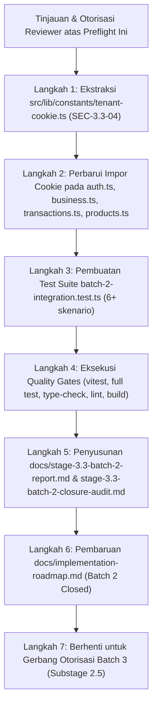

# VeyraOS — Preflight Report: Substage 3.3.2.4
## Batch 2 Consolidated Integration, Closure Audit & Gate Review

**Proyek:** VeyraOS  
**Fase:** Phase 4 — Application & Service Integration Layer  
**Tahap / Batch:** Stage 3.3 Batch 2 — Substage 2.4  
**Status Preflight:** **READY WITH CONDITIONS (PREFLIGHT AUDIT COMPLETE — AWAITING REVIEWER AUTHORIZATION)**  
**Tanggal:** 14 Oktober 2026  
**Auditor / Arsitek:** Principal Systems Architect & Lead Security Engineer  

---

## 1. Executive Summary

Laporan preflight ini disusun sebagai persiapan teknis formal sebelum pelaksanaan **Substage 2.4 pada Stage 3.3** berdasarkan dokumen otoritatif proyek VeyraOS ([`docs/implementation-roadmap.md`](file:///c:/Antigravity%20Project/VeyraOS/docs/implementation-roadmap.md), [`docs/stage-3.3-preflight-report.md`](file:///c:/Antigravity%20Project/VeyraOS/docs/stage-3.3-preflight-report.md), dan [`docs/stage-3.3-batch-2-preflight-report.md`](file:///c:/Antigravity%20Project/VeyraOS/docs/stage-3.3-batch-2-preflight-report.md)).

Sesuai pembagian siklus rilis Stage 3.3:
- **Batch 1 (Selesai & Diremediasi):** Autentikasi (`auth.ts`) & Preferensi Tenant (`business.ts`) dengan penegakan Anti-Silent Fallback dan semantik konfirmasi email GoTrue.
- **Batch 2 (Substage 2.1–2.3 Selesai):** Transaksi Kasir POS (`transactions.ts`), Katalog Produk & Persediaan (`products.ts`), serta penyesuaian error mapper `PRODUCT_ARCHIVED`.
- **Substage 2.4 (Fokus Tahap Ini):** **Batch 2 Consolidated Integration Validation, Closure Audit & Gate Review**. Tahap ini berfungsi sebagai gerbang penutupan resmi seluruh Batch 2 sebelum otorisasi pembukaan Batch 3 (Beban Operasional & Laporan Finansial).

### Batasan Preflight yang Ditaati:
- **Zero Code Modification:** Tidak ada berkas kode sumber aplikasi (`src/`) atau pengujian (`*.test.ts`) yang diedit pada tahap preflight ini.
- **Zero Database Mutation:** Database Supabase live tetap murni tanpa mutasi data atau pemanggilan RPC live.
- **Zero Migration Execution:** Berkas proposal migrasi `20261014000012_reject_archived_products_in_sales.sql` tetap berstatus *unexecuted*.
- **Zero Git Commit:** Tidak ada commit git yang dibuat.

---

## 2. Official Roadmap Scope

Berdasarkan penelusuran terhadap dokumen roadmap resmi proyek:

1. **[`docs/implementation-roadmap.md#L161-L165`](file:///c:/Antigravity%20Project/VeyraOS/docs/implementation-roadmap.md#L161-L165):**
   ```markdown
   | **Stage 3.3 (Batch 2 - Substage 2.1)** | Error Mapper Audit & Forward Compatibility (PRODUCT_ARCHIVED) | PASS |
   | **Stage 3.3 (Batch 2 - Substage 2.2)** | Transaction Server Actions (transactions.ts, DI & Idempotency Remediated) | PASS WITH CONDITIONS |
   | **Stage 3.3 (Batch 2 - Substage 2.3)** | Product Server Actions (products.ts, Ledger & Stock Integrity Enforced) | PASS WITH CONDITIONS |
   | **Stage 3.3 (Batch 2 - Substage 2.4 - 2.5)** | Substage 2.4 Closure Audit & Gate Review Batch 2 | PENDING AUTHORIZATION |
   ```

2. **[`docs/stage-3.3-batch-2-preflight-report.md#L234-L245`](file:///c:/Antigravity%20Project/VeyraOS/docs/stage-3.3-batch-2-preflight-report.md#L234-L245):**
   - *Langkah 1:* Update `error-mapper.ts` (`PRODUCT_ARCHIVED`) -> Substage 2.1 (**SELESAI**)
   - *Langkah 2:* Implementasi `transactions.ts` & `transactions.test.ts` -> Substage 2.2 (**SELESAI & DIREMEDIASI**)
   - *Langkah 3:* Implementasi `products.ts` & `products.test.ts` -> Substage 2.3 (**SELESAI & DIAUDIT**)
   - *Langkah 4:* Penyusunan Laporan Validasi Batch 2 & Closure Audit Batch 2 -> **Substage 2.4**
   - *Gerbang Otorisasi:* Reviewer Decision untuk membuka Batch 3 -> **Substage 2.5**

3. **Tujuan Resmi Substage 2.4:**
   - Melakukan pengujian integrasi lintas Server Action (*Cross-Action Integration Testing*) antara modul transaksi kasir/pembelian (`transactions.ts`) dan modul katalog produk (`products.ts`).
   - Menyelesaikan atau mengonsolidasikan temuan P3 teridentifikasi (SEC-3.3-04: ekstraksi konstanta cookie tenant bersama).
   - Menyusun laporan validasi terpadu Batch 2 (`docs/stage-3.3-batch-2-report.md`) dan audit penutupan Batch 2 (`docs/stage-3.3-batch-2-closure-audit.md`).
   - Mengesahkan kepatuhan seluruh Quality Gates untuk gerbang otorisasi Batch 3.

---

## 3. Existing Implementation Inventory

Seluruh fondasi kode untuk Batch 2 telah lengkap diimplementasikan pada Substage 2.1–2.3:

### 3.1 Lapisan Service Layer (`src/services/`)
- [`src/services/transactions/transaction.service.ts`](file:///c:/Antigravity%20Project/VeyraOS/src/services/transactions/transaction.service.ts):
  - `recordSale`: Eksekusi penjualan kasir via Stored Procedure `record_sale_transaction`, penomoran faktur CSPRNG server-authoritative, validasi Zod, advisory locking idempotensi.
  - `recordPurchase`: Eksekusi restock via Stored Procedure `record_purchase_transaction`, rekalkulasi Moving Weighted Average Cost (MWAC).
  - `voidSale`: Eksekusi pembatalan transaksi via Stored Procedure `void_sale_transaction`, pembalikan stok fisik atomik.
  - `getProductsForTransaction`: Query produk aktif kasir non-arsip (`is_archived = false`).
- [`src/services/products/product.service.ts`](file:///c:/Antigravity%20Project/VeyraOS/src/services/products/product.service.ts):
  - `createProduct`: Pendaftaran produk baru (stok 0); menolak stok awal $> 0$ (`ATOMIC_INITIAL_STOCK_UNAVAILABLE`).
  - `getProducts`: Query katalog dengan filter kategori, pencarian teks (nama & SKU), stok menipis, dan arsip.
  - `getProductById`: Detail produk dengan isolasi tenant wajib (`business_id`).
  - `updateProduct`: Pembaruan metadata produk; menolak mutasi langsung stok/HPP (`FORBIDDEN_FIELD_MUTATION`).
  - `archiveProduct`: Soft-delete (`is_archived = true`), menolak hard-delete fisik.
- [`src/services/transactions/error-mapper.ts`](file:///c:/Antigravity%20Project/VeyraOS/src/services/transactions/error-mapper.ts):
  - Pemetaan error domain PostgreSQL/RPC ke amplop `ApiResponse<T>`, termasuk penanganan `PRODUCT_ARCHIVED` (Substage 2.1).
- [`src/services/common/auth-guard.ts`](file:///c:/Antigravity%20Project/VeyraOS/src/services/common/auth-guard.ts):
  - `verifyUserAndBusinessMembership`: Pengecekan sesi Supabase Auth dan keanggotaan bisnis aktif di database.

### 3.2 Lapisan Server Actions (`src/app/actions/`)
- [`src/app/actions/transactions.ts`](file:///c:/Antigravity%20Project/VeyraOS/src/app/actions/transactions.ts):
  - Mengimplementasikan 4 aksi server: `createSaleAction`, `recordPurchaseAction`, `voidSaleAction`, `getProductsForTransactionAction`.
  - Bersih dari parameter dependency injection testing (remediasi SEC-3.3-05).
  - Fail-closed pada ketiadaan `idempotencyKey` tanpa membangkitkan UUID acak di server (remediasi SEC-3.3-06).
- [`src/app/actions/products.ts`](file:///c:/Antigravity%20Project/VeyraOS/src/app/actions/products.ts):
  - Mengimplementasikan 5 aksi server: `createProductAction`, `getProductsAction`, `getProductByIdAction`, `updateProductAction`, `archiveProductAction`.
  - Menerapkan pertahanan integritas persediaan: menolak `stockQuantity` dan `costPrice` pada update, menolak stok awal $> 0$ pada create.
  - Mendukung signature polimorfis `(id, input)` dan `({ productId, ...input })`.

### 3.3 Inventaris Suite Pengujian Unit Terkini
- **Total Pengujian Repositori:** **419 unit tests lulus 100%** (19 berkas pengujian).
  - `src/app/actions/transactions.test.ts`: 23 tests lulus.
  - `src/app/actions/products.test.ts`: 30 tests lulus.
  - `src/app/actions/business.test.ts`: 17 tests lulus.
  - `src/app/actions/auth.test.ts`: 24 tests lulus.
  - Service layer & library tests: 325 tests lulus.

---

## 4. Proposed File-Level Implementation Plan for Substage 2.4

Pelaksanaan Substage 2.4 mencakup paket pekerjaan berikut:

| Berkas Target | Tindakan | Peran & Alasan Teknis |
|---|---|---|
| [`src/lib/constants/tenant-cookie.ts`](file:///c:/Antigravity%20Project/VeyraOS/src/lib/constants/tenant-cookie.ts) | **Dibuat Baru (Refactoring)** | Mengonsolidasikan konstanta `TENANT_COOKIE_NAME` dan `TENANT_COOKIE_OPTIONS` ke dalam modul tunggal untuk menutup temuan **SEC-3.3-04** di seluruh Server Actions (`auth.ts`, `business.ts`, `transactions.ts`, `products.ts`). |
| [`src/app/actions/batch-2-integration.test.ts`](file:///c:/Antigravity%20Project/VeyraOS/src/app/actions/batch-2-integration.test.ts) | **Dibuat Baru (Testing)** | Suite pengujian integrasi lintas Server Action (Cross-Action E2E Workflows) memvalidasi skenario siklus hidup produk-transaksi terpadu. |
| [`src/app/actions/auth.ts`](file:///c:/Antigravity%20Project/VeyraOS/src/app/actions/auth.ts) | **Diperbarui (Impor)** | Mengganti definisi lokal cookie dengan impor dari `@/lib/constants/tenant-cookie`. |
| [`src/app/actions/business.ts`](file:///c:/Antigravity%20Project/VeyraOS/src/app/actions/business.ts) | **Diperbarui (Impor)** | Mengganti definisi lokal cookie dengan impor dari `@/lib/constants/tenant-cookie`. |
| [`src/app/actions/transactions.ts`](file:///c:/Antigravity%20Project/VeyraOS/src/app/actions/transactions.ts) | **Diperbarui (Impor)** | Mengganti definisi lokal cookie dengan impor dari `@/lib/constants/tenant-cookie`. |
| [`src/app/actions/products.ts`](file:///c:/Antigravity%20Project/VeyraOS/src/app/actions/products.ts) | **Diperbarui (Impor)** | Mengganti definisi lokal cookie dengan impor dari `@/lib/constants/tenant-cookie`. |
| `docs/stage-3.3-batch-2-report.md` | **Dibuat Baru (Dokumentasi)** | Laporan validasi komprehensif penutupan Batch 2 (Transaksi POS & Katalog Produk). |
| `docs/stage-3.3-batch-2-closure-audit.md` | **Dibuat Baru (Dokumentasi)** | Audit penutupan formal Batch 2 mengevaluasi status seluruh temuan keamanan dan gerbang otorisasi Batch 3. |
| [`docs/implementation-roadmap.md`](file:///c:/Antigravity%20Project/VeyraOS/docs/implementation-roadmap.md) | **Diperbarui (Status)** | Memperbarui log status Substage 2.4 dan menandai Batch 2 sebagai ditutup. |

---

## 5. Dependencies and Integration Points

```
+------------------------------------------------------------------------------------------+
| Substage 2.1 (Selesai): Error Mapper Forward Compatibility (PRODUCT_ARCHIVED)            |
+------------------------------------------------------------------------------------------+
                                              │
                                              ▼
+------------------------------------------------------------------------------------------+
| Substage 2.2 (Selesai & Diremediasi): Transaction Server Actions (transactions.ts)       |
| • createSaleAction (Fail-closed idempotency, no DI)                                      |
| • recordPurchaseAction, voidSaleAction, getProductsForTransactionAction                  |
+------------------------------------------------------------------------------------------+
                                              │
                                              ▼
+------------------------------------------------------------------------------------------+
| Substage 2.3 (Selesai & Diaudit): Product Server Actions (products.ts)                   |
| • createProductAction (Stok awal 0, ATOMIC_INITIAL_STOCK_UNAVAILABLE)                    |
| • updateProductAction (FORBIDDEN_FIELD_MUTATION pada stok/HPP)                           |
| • getProductsAction, getProductByIdAction, archiveProductAction (Soft-delete)            |
+------------------------------------------------------------------------------------------+
                                              │
                                              ▼
+------------------------------------------------------------------------------------------+
| SUBSTAGE 2.4 (FOKUS SEKARANG): Batch 2 Consolidated Integration & Closure Audit          |
| 1. Ekstraksi shared constants tenant-cookie.ts (Menutup SEC-3.3-04)                      |
| 2. Cross-Action Integration Testing (batch-2-integration.test.ts)                        |
| 3. Verifikasi Quality Gates: 425+ unit tests, tsc, eslint, next build                    |
| 4. Penyusunan stage-3.3-batch-2-report.md & stage-3.3-batch-2-closure-audit.md           |
+------------------------------------------------------------------------------------------+
                                              │
                                              ▼
+------------------------------------------------------------------------------------------+
| SUBSTAGE 2.5 (Gerbang Otorisasi): Reviewer Approval Gate to Unlock Batch 3               |
| • Batch 3 Scope: expenses.ts, reports.ts                                                 |
+------------------------------------------------------------------------------------------+
```

---

## 6. Security and Tenant-Isolation Requirements

1. **Prinsip Nol Parameter Testing DI pada Kontrak Publik:**
   - Tidak ada parameter `options?: ...`, `supabase?: SupabaseClient`, atau `userId?: string` yang diizinkan pada signature Server Action publik mana pun di Batch 2.
2. **Pola Fail-Closed Resolusi Tenant:**
   - Client-provided `businessId` dan active cookie `veyra_active_business_id` hanya merupakan preferensi perutean tenant, bukan bukti keabsahan otorisasi.
   - Setiap aksi memverifikasi keanggotaan tenant server-authoritative (`verifyUserAndBusinessMembership`).
   - Cookie rusak dibersihkan seketika dan ditolak dengan `VALIDATION_ERROR` (*Anti-Silent Fallback*).
   - Pengguna non-anggota ditolak dengan `UNAUTHORIZED_BUSINESS` dan cookie dibersihkan.
3. **Resiliensi Pembersihan Cookie:**
   - Kegagalan `cookies().delete()` dibungkus dalam blok proteksi `try/catch` sehingga tidak pernah menggagalkan atau melemahkan keputusan penolakan otorisasi.
4. **Isolasi Query Multi-Tenant:**
   - Query pencarian produk, kasir, faktur, dan arsip terisolasi permanen di bawah klausa wajib `.eq("business_id", resolvedBusinessId)`. Tidak ada celah kebocoran data antar-tenant.

---

## 7. Data Integrity and Business Rules

1. **Perlindungan Integritas Ledger Persediaan:**
   - Mutasi stok dan HPP hanya boleh terjadi melalui transaksi audit:
     - Penambahan stok & rekalkulasi MWAC: `recordPurchaseAction`
     - Pengurangan stok kasir: `createSaleAction`
     - Pembalikan stok: `voidSaleAction`
   - Pembaruan langsung stok atau HPP via `updateProductAction` diblokir seketika (`FORBIDDEN_FIELD_MUTATION`).
2. **Aturan Stok Awal Produk:**
   - Pembuatan produk dengan stok awal $> 0$ diblokir sebelum mutasi (`ATOMIC_INITIAL_STOCK_UNAVAILABLE`) untuk mencegah ketidaksinkronan antara tabel `products` dan `stock_movements`.
3. **Integritas Relasional Data Historis:**
   - Pengarsipan produk berstatus soft-delete (`is_archived = true`). Hard-delete dilarang untuk mencegah pelanggaran foreign key `RESTRICT` pada riwayat transaksi penjualan/pembelian lama.
4. **Kontrak Idempotensi Transaksi:**
   - Klien POS wajib menyertakan `idempotencyKey` (minimal 8 karakter). Ketiadaan key ditolak secara fail-closed tanpa pembuatan UUID palsu di server.

---

## 8. Test Plan untuk Substage 2.4

### 8.1 Skenario Pengujian Integrasi Lintas Server Action (`batch-2-integration.test.ts`)
Target: Minimal **6 skenario integrasi menyeluruh (*cross-action workflows*)**:
1. **Siklus Hidup Restock Produk:**
   - `createProductAction` mendaftarkan produk dengan stok 0.
   - `recordPurchaseAction` mencatat pembelian barang masuk 10 unit dengan harga beli Rp 50.000.
   - `getProductByIdAction` memvalidasi bahwa stok dan HPP produk kini terisi secara sah.
2. **Siklus Penjualan Kasir POS:**
   - `getProductsForTransactionAction` memverifikasi produk muncul di katalog aktif kasir.
   - `createSaleAction` mengeksekusi penjualan kasir 2 unit.
   - Memverifikasi transaksi menghasilkan tanda terima sah (`SaleReceiptResponse`).
3. **Siklus Pengarsipan & Penolakan Kasir:**
   - `archiveProductAction` mengarsipkan produk (`is_archived = true`).
   - `getProductsForTransactionAction` memverifikasi produk terarsip **tidak lagi muncul** di daftar kasir aktif.
   - `getProductsAction({ includeArchived: true })` membuktikan produk tetap dapat dilihat di master katalog manajerial.
4. **Pembalikan Stok Kasir via Void:**
   - `voidSaleAction` membatalkan transaksi penjualan dengan alasan sah.
   - Memverifikasi transaksi berstatus `VOIDED` dan data audit tercatat.
5. **Pencegahan Mutasi Ilegal Antar-Modul:**
   - `updateProductAction` mencoba mengubah `stockQuantity` produk -> ditolak seketika (`FORBIDDEN_FIELD_MUTATION`).
   - `createProductAction` mencoba membuat produk dengan `stockQuantity: 10` -> ditolak seketika (`ATOMIC_INITIAL_STOCK_UNAVAILABLE`).
6. **Penegakan Isolasi Multi-Tenant Lintas Modul:**
   - Transaksi atau produk dari Bisnis A dicoba diakses menggunakan konteks Bisnis B -> ditolak dengan `UNAUTHORIZED_BUSINESS` atau `NOT_FOUND`.

### 8.2 Verifikasi Seluruh Quality Gates
Perintah wajib yang harus dijalankan:
1. `npx vitest run src/app/actions/batch-2-integration.test.ts`
2. `npm test` (Target: $\ge 425$ tests lulus 100%)
3. `npm run type-check` (`tsc --noEmit` -> 0 errors)
4. `npm run lint` (`eslint` -> 0 errors, 0 warnings)
5. `npm run build` (`next build` Turbopack -> sukses)

---

## 9. Risks and Unresolved Questions

### 9.1 Matriks Risiko Teknis
| Risiko Teridentifikasi | Severity | Mitigasi yang Ditetapkan |
|---|---|---|
| **Kesenjangan Proteksi Live Database Produk Terarsip (SEC-3.3-07)** | P2 (Medium) | Proposal migrasi `012` telah disiapkan. Pada layer aplikasi, Server Actions kasir memfilter `is_archived = false`. Eksekusi migrasi live dijadwalkan pada jendela pemeliharaan resmi database sebelum rilis produksi Tahap 10. |
| **Ketiadaan Stored Procedure Stok Awal Atomik (SEC-3.3-08)** | P2 (Medium) | Server Actions secara fail-closed menolak stok awal $> 0$ (`ATOMIC_INITIAL_STOCK_UNAVAILABLE`). Pengguna diarahkan menggunakan alur dua langkah: buat produk stok 0, lalu restock via pembelian persediaan. |
| **Jaminan Idempotensi Retry Klien Belum Lengkap (SEC-3.3-06)** | P2 (Medium) | Server Actions telah fail-closed (menolak transaksi tanpa key). Jaminan bebas duplikasi menyeluruh (*end-to-end*) diwajibkan pada antarmuka kasir POS (Fase 5) untuk membangkitkan dan mempertahankan UUID klien saat dialog transaksi berlangsung. |
| **Duplikasi Konstanta Cookie Tenant (SEC-3.3-04)** | P3 (Low) | Diselesaikan pada Substage 2.4 melalui ekstraksi modul bersama `src/lib/constants/tenant-cookie.ts`. |

### 9.2 Pertanyaan Terbuka untuk Reviewer
1. **Lingkup Refactoring Cookie Constants (SEC-3.3-04):**  
   Apakah reviewer menyetujui pembersihan dan konsolidasi konstanta cookie ke `src/lib/constants/tenant-cookie.ts` pada Substage 2.4, ataukah perubahan ini harus ditunda ke batch refactoring terpisah?
2. **Klarifikasi Batas Batch 3:**  
   Ditegaskan bahwa `src/app/actions/expenses.ts` dan `src/app/actions/reports.ts` **sepenuhnya berada di luar cakupan Substage 2.4** dan merupakan bagian dari Batch 3. Apakah reviewer mengonfirmasi bahwa Substage 2.4 murni berfokus pada penutupan Batch 2?

---

## 10. Objective Acceptance Criteria

Substage 2.4 dinyatakan selesai dan memenuhi syarat penutupan apabila:
1. Suite pengujian integrasi lintas modul `src/app/actions/batch-2-integration.test.ts` berhasil dibuat dan seluruh skenarionya lulus 100%.
2. (Jika diotorisasi) Modul `src/lib/constants/tenant-cookie.ts` dibuat dan digunakan seragam di 4 berkas Server Actions, menutup temuan P3 SEC-3.3-04.
3. Seluruh suite pengujian repositori (`npm test`) mencapai $\ge 425$ tests lulus tanpa kegagalan.
4. Seluruh 4 Quality Gates (`test`, `type-check`, `lint`, `build`) lulus 100% tanpa error dan tanpa warning.
5. Dokumen laporan validasi Batch 2 (`docs/stage-3.3-batch-2-report.md`) dan audit penutupan Batch 2 (`docs/stage-3.3-batch-2-closure-audit.md`) tersusun lengkap.
6. Tidak ada database mutation live, tidak ada migrasi yang dieksekusi, dan tidak ada git commit.
7. Tidak ada kode Batch 3 (`expenses.ts`, `reports.ts`) yang dibuat secara prematur.

---

## 11. Implementation Sequence Proposal



---

## 12. Explicit Out-of-Scope Items

Hal-hal berikut **DILARANG dan BERADA DI LUAR RUANG LINGKUP** Substage 2.4:
1. **Server Actions Beban Operasional (`expenses.ts`):** Merupakan deliverable resmi Stage 3.3 Batch 3.
2. **Server Actions Analitik & Laporan Finansial (`reports.ts`):** Merupakan deliverable resmi Stage 3.3 Batch 3.
3. **Pembuatan UI atau Komponen Halaman:** Antarmuka kasir POS, antarmuka produk, dashboard, dan form web berada di bawah Fase 5 Roadmap.
4. **Eksekusi Migrasi SQL Database:** Berkas `20261014000012_reject_archived_products_in_sales.sql` dilarang dieksekusi pada database live.
5. **Git Commits & Branch Switching:** Repositori harus tetap berada pada branch kerja saat ini tanpa commit.

---

## 13. Preflight Verdict

```
================================================================================
                    PREFLIGHT VERDICT: SUBSTAGE 3.3.2.4
================================================================================
  Verdict Resmi:    READY WITH CONDITIONS
  Kondisi 1:        Substage 2.4 didefinisikan sebagai Batch 2 Consolidated
                    Integration Validation, Closure Audit, & Gate Review.
  Kondisi 2:        Batch 3 (expenses.ts, reports.ts) tetap terkunci hingga
                    Substage 2.4 dan Gate Review Batch 2 selesai disetujui.
  Kondisi 3:        Pembersihan konstanta cookie (SEC-3.3-04) diotorisasi untuk
                    diselesaikan sebagai bagian dari konsolidasi Batch 2.
  Status Kode:      PRISTINE — BELUM ADA PERUBAHAN KODE / DATABASE
  Tindakan:         STOP & MENUNGGU PERSETUJUAN EKSPLISIT REVIEWER
================================================================================
```

Pekerjaan dihentikan pada titik ini. Tidak ada modifikasi kode yang akan dilakukan sebelum reviewer memberikan otorisasi eksplisit atas rencana preflight ini.
