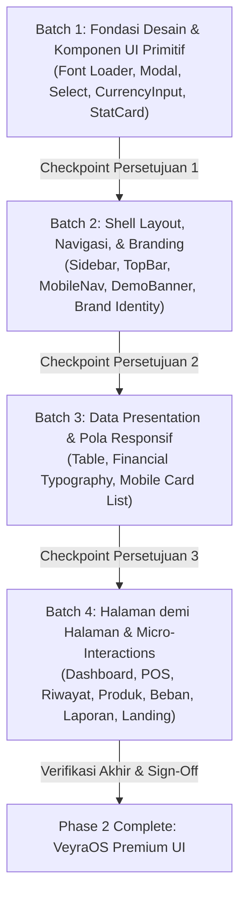

# VeyraOS — UI Polish Phase 1: Design Audit & Planning Report

**Document Version:** 1.0.0  
**Phase:** UI Polish Phase 1 — Design Audit & Planning  
**Execution Mode:** READ-ONLY (No source code, design tokens, documentation, dependencies, or git staging modified)  
**Target File:** `docs/ui-polish-phase-1-design-audit.md`  
**Brand Foundation:** Royal Violet Design System  
**Auditor:** Senior Full-Stack Engineer / Design Systems Specialist  
**Date:** 16 Oktober 2026

---

## 1. Executive Summary & Kondisi Aktual

Audit UI/UX menyeluruh ini dilakukan untuk memetakan kualitas antarmuka VeyraOS di seluruh halaman publik, otentikasi, dashboard produksi, dan simulasi Mode Demo yang terisolasi. Tujuannya adalah menyiapkan blueprint eksekusi visual upgrade yang menjadikan VeyraOS berkarakter **premium, elegan, modern, profesional, dan responsif**, terhindar dari kesan template SaaS generik atau "AI-slop".

### 1.1 Kondisi Aktual Berdasarkan Source Code
1. **Fondasi Desain Sudah Kokoh tetapi Belum Merata:**
   - Palet warna inti Royal Violet (`#5B3CC4`, `#4930A5`, `#392477`, `#EAE4FF`, `#FAF9F6`, `#25232B`, `#716D7A`, `#E7E3EC`) telah terdefinisi di `docs/design-system.md` dan dideklarasikan di `src/app/globals.css`.
   - Komponen primitif di `src/components/ui/` (`button.tsx`, `input.tsx`, `badge.tsx`, `card.tsx`, `table.tsx`, `alert.tsx`, `empty-state.tsx`, `skeleton.tsx`, `brand-logo.tsx`) memiliki implementasi dasar yang bersih dan bebas error.
2. **Kesenjangan Tipografi Finansial:**
   - Font `Plus Jakarta Sans` dimuat dengan benar via `next/font/google` di `src/app/layout.tsx`.
   - Namun, font `JetBrains Mono` yang disyaratkan spesifikasi untuk angka tabel finansial (`tabular-nums`) **belum dimuat** melalui Next.js font loader di `layout.tsx`, melainkan hanya dideklarasikan di CSS fallback. Pada perangkat pengguna yang tidak memiliki JetBrains Mono lokal, tampilan angka jatuh ke generic monospace/Consolas.
3. **Abstraksi Komponen yang Belum Lengkap:**
   - Komponen penting yang dijanjikan pada `docs/design-acceptance-criteria.md` seperti `Modal.tsx`, `Select.tsx`, `CurrencyInput.tsx`, dan `StatCard.tsx` **belum diimplementasikan sebagai komponen bersama (shared UI primitives)**.
   - Akibatnya, halaman kasir POS Demo (`src/app/demo/sales/new/page.tsx`) dan riwayat penjualan Demo (`src/app/demo/sales/page.tsx`) membuat dialog modal dan backdrop secara *inline* dengan variabel styling berbeda (`bg-black/55` vs `bg-black/60`).
4. **Penyimpangan Warna pada Modul Beban Operasional:**
   - Halaman Beban (`src/app/expenses/page.tsx`) mendefinisikan `EXPENSE_CATEGORIES` dengan utilitas Tailwind pelangi (`bg-slate-100`, `bg-blue-100`, `bg-amber-100`, `bg-rose-100`, `bg-purple-100`, `bg-orange-100`, `bg-emerald-100`). Ini bertentangan langsung dengan aturan `docs/design-system.md` (bagian 3.2: *"Hindari warna-warni pelangi. Gunakan aksen warna hanya untuk status yang membutuhkan perhatian khusus"*).
5. **Responsivitas Tabel & Touch Target Mobile:**
   - Halaman Demo Sales History (`src/app/demo/sales/page.tsx`) telah mengadopsi pola responsif yang sangat baik: tabel di desktop (`hidden md:table`) dan *card list* berstruktur di mobile (`md:hidden`).
   - Namun, halaman Produksi (`src/app/products/page.tsx` dan `src/app/reports/page.tsx`) masih mengandalkan tabel desktop dengan horizontal scrollbar (`overflow-x-auto`), yang memberikan pengalaman mobile yang kurang ergonomis.
   - Beberapa tombol berukuran `size="sm"` memiliki tinggi 32px (`min-h-[32px]`), yang berada di bawah standar rekomendasi touch target mobile (minimal 44px).

---

## 2. Inventaris Komponen & Halaman

Tabel berikut memetakan seluruh komponen dan halaman yang ada dalam kode sumber VeyraOS saat ini, status implementasinya, dan kesesuaiannya dengan spesifikasi desain.

### 2.1 Komponen UI Primitif (`src/components/ui/`)

| Komponen | Path File | Status Spesifikasi | Status Aktual | Catatan Kualitas Visual |
| :--- | :--- | :--- | :--- | :--- |
| **BrandLogo** | `src/components/ui/brand-logo.tsx` | Sesuai | Terimplementasi | SVG monogram V dengan gradient Royal Violet `#5B3CC4` ke `#392477`. Bersih, vektor tajam, mendukung prop `size` (`sm`, `md`, `lg`). |
| **Button** | `src/components/ui/button.tsx` | Parsial | Terimplementasi | Varian `primary`, `secondary`, `outline`, `ghost`, `danger`. Sudah memiliki `focus-visible:ring-2`. Ukuran `sm` (h-8/32px) memerlukan penyesuaian mobile touch target. Belum ada varian icon-only square button yang konsisten. |
| **Input** | `src/components/ui/input.tsx` | Sesuai | Terimplementasi | Border `#E7E3EC`, focus ring violet `#5B3CC4`. Mendukung helper text, error text, dan disabled state. |
| **Badge** | `src/components/ui/badge.tsx` | Parsial | Terimplementasi | Varian `default`, `success`, `warning`, `danger`, `info`. Varian `default` menggunakan background violet tint (`#EAE4FF`) yang elegan. |
| **Card** | `src/components/ui/card.tsx` | Parsial | Terimplementasi | Border halus `border-border/60`, bg-white, shadow-card (`0 1px 3px rgba(0,0,0,0.06)`). Belum memiliki utility interaktif `hover:shadow-md` untuk card klik-able. |
| **Table** | `src/components/ui/table.tsx` | Parsial | Terimplementasi | Abstraksi `Table`, `TableHeader`, `TableBody`, `TableRow`, `TableCell`. Header berwarna `bg-cream-100` / `#FAF9F6`. Angka finansial belum otomatis memicu class font mono tabular. |
| **Alert** | `src/components/ui/alert.tsx` | Sesuai | Terimplementasi | Varian `info`, `success`, `warning`, `danger`. Ikon SVG inline konsisten. Radius `rounded-xl`. |
| **EmptyState** | `src/components/ui/empty-state.tsx` | Parsial | Terimplementasi | Ikon box svg sederhana, judul, deskripsi, dan slot action button. Visual terasa fungsional namun masih agak standar. |
| **Skeleton** | `src/components/ui/skeleton.tsx` | Sesuai | Terimplementasi | `animate-pulse bg-gray-200/70 rounded-lg`. Animasi halus dan konsisten. |
| **Modal / Dialog** | *Belum ada file terpusat* | Tertunda | **Hilang** | Tidak ada di `src/components/ui/`. Diimplementasikan ad-hoc di `demo/sales/page.tsx` dan `demo/sales/new/page.tsx`. |
| **Select** | *Belum ada file terpusat* | Tertunda | **Hilang** | Menggunakan elemen native `<select>` dengan styling berbeda di tiap halaman. |
| **CurrencyInput**| *Belum ada file terpusat* | Tertunda | **Hilang** | Formatting angka rupiah direplikasi manual dengan regex di POS Kasir dan halaman input lainnya. |
| **StatCard** | *Belum ada file terpusat* | Tertunda | **Hilang** | Kartu metrik KPI (Revenue, Net Profit, Transaksi) dibuat manual menggunakan kombinasi `Card`, `Badge`, dan icon wrapper di setiap halaman dashboard. |

### 2.2 Komponen Layout & Navigasi

| Komponen | Path File | Cakupan | Catatan Visual |
| :--- | :--- | :--- | :--- |
| **Sidebar (Produksi)** | `src/components/layout/sidebar.tsx` | Desktop | Lebar `w-64`, border kanan `#E7E3EC`, background putih bersih. Navigasi rapi dengan active indicator violet (`bg-primary-50 text-primary-700`). Badge versi VeyraOS di footer. |
| **DemoSidebar** | `src/components/demo/demo-sidebar.tsx` | Desktop Demo | Mirip dengan sidebar produksi namun menandai menu di luar Scope Demo (Produk, Beban, Laporan, Pengaturan) dengan badge "Segera Hadir" dan ikon gembok, `cursor-not-allowed`. |
| **TopBar** | `src/components/layout/top-bar.tsx` | Global Shell | Menampilkan judul rute dinamis, status online/sinkronisasi, dan profil bisnis. Terdapat tombol toggle mobile menu (`lg:hidden`). |
| **MobileNav** | `src/components/layout/mobile-nav.tsx` | Mobile Shell | Dialog overlay drawer slide-in dari kiri dengan backdrop `bg-black/50`. Menampilkan link navigasi lengkap dan informasi bisnis. |
| **DemoBanner** | `src/components/demo/demo-banner.tsx` | Demo Mode | Banner fixed di bagian atas dengan aksen Royal Violet lembut (`bg-primary-50 border-primary-200`), tombol reset data demo, dan link menuju pendaftaran akun riil. |

### 2.3 Inventaris Halaman Aplikasi

| Halaman / Rute | Path File | Tipe | Evaluasi Visual & Responsivitas |
| :--- | :--- | :--- | :--- |
| **Landing Page** | `src/app/page.tsx` | Publik | Hero section modern dengan gradient violet halus, showcase fitur, pricing tier, CTA "Coba Demo Interaktif" dan "Mulai Sekarang". Sangat rapi. |
| **Login** | `src/app/login/page.tsx` | Otentikasi | Centered card layout berlatar `#FAF9F6`. Form input bersih, tombol login dengan state loading, link menuju registrasi dan demo. |
| **Register** | `src/app/register/page.tsx` | Otentikasi | Form 2-langkah (akun & profil usaha). Card terpusat, validasi visual jelas. |
| **Dashboard Produksi** | `src/app/dashboard/page.tsx` | Produksi | Grid stat card KPI, grafik simulasi penjualan 7 hari, tabel transaksi terbaru. Rapi di desktop, tapi butuh kartu metrik yang lebih tegas di layar kecil. |
| **Demo POS Kasir** | `src/app/demo/sales/new/page.tsx` | Mode Demo | Layout 2-kolom (Katalog Produk & Keranjang Transaksi). Search bar, filter kategori, panel pembayaran instan (Tunai, QRIS, Transfer). Responsif di mobile (keranjang mengambang / toggle bawah). Sangat interaktif. |
| **Demo Riwayat Penjualan** | `src/app/demo/sales/page.tsx` | Mode Demo | Filter tanggal/status, tabel desktop dan card list mobile yang sangat ergonomis. Modal detail transaksi dan dialog Void/Pembatalan dengan validasi alasan. |
| **Produk (Produksi)** | `src/app/products/page.tsx` | Produksi | Daftar inventaris barang, HPP, harga jual, stok minimum, status batch. Menggunakan tabel horizontal scroll; belum memiliki mobile card-list. |
| **Beban Operasional** | `src/app/expenses/page.tsx` | Produksi | Form pencatatan beban, ringkasan per kategori, tabel pengeluaran. **Ditemukan inkonsistensi warna kategori pelangi**. |
| **Laporan Finansial** | `src/app/reports/page.tsx` | Produksi | Laporan Laba Rugi ringkas (Omzet, HPP, Laba Kotor, Beban, Laba Bersih) dan Arus Kas. Membutuhkan format tabular angka yang lebih kokoh. |
| **Pengaturan Bisnis** | `src/app/settings/page.tsx` | Produksi | Profil bisnis, pengaturan struk kasir, preferensi mata uang, tax & service. Tab navigasi fungsional. |

---

## 3. Temuan Hasil Audit Berdasarkan Severity

Semua temuan di bawah ini bersumber langsung dari hasil penelusuran kode sumber aktual, bukan estimasi atau asumsi.

### 3.1 Critical Severity (0 Temuan)
*Tidak ditemukan bug kritis pada tampilan yang merusak fungsionalitas aplikasi atau menyebabkan runtime crash pada versi saat ini.*

---

### 3.2 High Severity (3 Temuan)

#### [HIGH-01] Font `JetBrains Mono` Tidak Dimuat di Next.js Font Loader
- **File:** `src/app/layout.tsx` (baris 8-15) & `src/app/globals.css` (baris 17)
- **Bukti Kode:**
  ```tsx
  // src/app/layout.tsx
  import { Plus_Jakarta_Sans } from "next/font/google";
  const plusJakartaSans = Plus_Jakarta_Sans({
    subsets: ["latin"],
    variable: "--font-sans",
    display: "swap",
  });
  ```
  ```css
  /* src/app/globals.css */
  --font-mono: 'JetBrains Mono', 'SFMono-Regular', Consolas, monospace;
  ```
- **Masalah:** Font `JetBrains Mono` merupakan bagian resmi dari spesifikasi desain VeyraOS (`docs/design-system.md` Bagian 2.1) untuk memastikan angka finansial tabular sejajar sempurna tanpa pergeseran lebar karakter (*tabular lining figures*). Karena font ini tidak di-load via `next/font/google` di `layout.tsx`, browser pengguna Windows akan jatuh ke *Consolas*, sedangkan macOS jatuh ke *SFMono-Regular*. Ini menyebabkan tampilan angka finansial berbeda antarperangkat dan mengurangi estetika premium aplikasi keuangan.
- **Dampak:** Penjajaran desimal dan digit rupiah pada tabel transaksi, struk POS, dan laporan laba-rugi terlihat kurang konsisten dan tidak seragam antar-OS.

#### [HIGH-02] Ketiadaan Komponen Abstraksi Modal / Dialog Bersama
- **File:** `src/app/demo/sales/page.tsx` (baris 452-520, 523-585) & `src/app/demo/sales/new/page.tsx` (baris 610-675)
- **Bukti Kode:**
  ```tsx
  // src/app/demo/sales/page.tsx (Detail Modal & Void Modal dibuat inline)
  <div className="fixed inset-0 z-50 flex items-center justify-center p-4 bg-black/60 backdrop-blur-sm animate-fade-in" ...>
    <div className="bg-white rounded-2xl max-w-lg w-full p-6 shadow-2xl ..." ...>
  ```
- **Masalah:** Tidak ada komponen `src/components/ui/modal.tsx` atau `dialog.tsx`. Setiap halaman yang memerlukan dialog (POS bayar, Void konfirmasi, Detail transaksi) membangun struktur modal dari nol dengan properti backdrop, animasi, z-index, dan trap-focus yang ditulis ulang.
- **Dampak:** Inkonsistensi UX (backdrop `bg-black/55` vs `bg-black/60`), risiko jebakan fokus aksesibilitas (a11y) saat tombol `Escape` ditekan, dan duplikasi kode DOM overlay yang tinggi.

#### [HIGH-03] Elemen Native `<select>` Tidak Konsisten & Kurang Elegan
- **File:** `src/app/demo/sales/page.tsx` (baris 320-330), `src/app/expenses/page.tsx` (baris 140-155), `src/app/products/page.tsx` (baris 85-98)
- **Bukti Kode:**
  ```tsx
  <select className="px-3 py-2 text-sm bg-white border border-border rounded-xl focus:outline-none focus:ring-2 focus:ring-primary/20 ...">
  ```
- **Masalah:** Menggunakan elemen `<select>` native HTML tanpa komponen pembungkus yang seragam. Ikon dropdown panah bawaan sistem operasi (Windows arrow) sangat kuno dan merusak nuansa desain kustom Royal Violet.
- **Dampak:** Mengurangi estetika modern SaaS pada form filter transaksi, form kategori barang, dan pilihan metode pembayaran.

---

### 3.3 Medium Severity (4 Temuan)

#### [MED-01] Pelanggaran Palet Desain: Penggunaan Warna Pelangi pada Kategori Beban
- **File:** `src/app/expenses/page.tsx` (baris 50-58)
- **Bukti Kode:**
  ```tsx
  const EXPENSE_CATEGORIES = [
    { id: 'bahan_baku', label: 'Bahan Baku', color: 'bg-blue-100 text-blue-700' },
    { id: 'sewa', label: 'Sewa Tempat', color: 'bg-purple-100 text-purple-700' },
    { id: 'gaji', label: 'Gaji Karyawan', color: 'bg-amber-100 text-amber-700' },
    { id: 'utilitas', label: 'Listrik & Air', color: 'bg-rose-100 text-rose-700' },
    { id: 'pemasaran', label: 'Pemasaran', color: 'bg-orange-100 text-orange-700' },
    { id: 'operasional', label: 'Operasional Lainnya', color: 'bg-emerald-100 text-emerald-700' },
  ];
  ```
- **Masalah:** Penggunaan badge warna-warni (biru, ungu, amber, mawar, oranye, zamrud) bertentangan langsung dengan aturan `docs/design-system.md` Bagian 3.2: *"Hindari warna-warni pelangi. Gunakan aksen warna hanya untuk status yang membutuhkan perhatian khusus"*.
- **Dampak:** Tampilan modul pengeluaran terlihat ramai, mencolok seperti template dashboard gratisan, dan mengaburkan hirarki visual utama.

#### [MED-02] Fragmentasi Format Finansial Rupiah di Seluruh Halaman
- **File:** `src/app/demo/sales/new/page.tsx` (baris 110-120), `src/app/demo/sales/page.tsx` (baris 45-52), `src/app/dashboard/page.tsx` (baris 35-40), `src/app/expenses/page.tsx` (baris 30-35)
- **Bukti Kode:**
  Setiap file mendefinisikan helper lokal secara mandiri:
  ```tsx
  const formatRupiah = (amount: number) => `Rp ${amount.toLocaleString('id-ID')}`;
  // Di file lain:
  const formatIDR = (val: number) => new Intl.NumberFormat('id-ID', { style: 'currency', currency: 'IDR', maximumFractionDigits: 0 }).format(val);
  ```
- **Masalah:** Duplikasi fungsi helper format mata uang. Beberapa menampilkan spasi setelah Rp (`Rp 50.000`), beberapa tanpa spasi (`Rp50.000`), dan beberapa tidak menyertakan class CSS `tabular-nums font-mono`.
- **Dampak:** Ketidakkonsistenan visual penyajian nominal uang di dashboard, struk, tabel, dan keranjang belanja.

#### [MED-03] Ketiadaan Komponen `CurrencyInput` Terdedikasi
- **File:** `src/app/demo/sales/new/page.tsx` (baris 210-230), `src/app/expenses/page.tsx` (baris 175-195)
- **Masalah:** Input nominal rupiah diimplementasikan ad-hoc menggunakan event `onChange` dengan parsing string manual `replace(/\D/g, '')`.
- **Dampak:** Pengalaman pengetikan angka kurang mulus (kursor melompat, tidak ada masking otomatis yang rapi) dan tidak sesuai dengan spesifikasi komponen `CurrencyInput` pada `docs/design-acceptance-criteria.md`.

#### [MED-04] Ketiadaan Transformasi Card List Mobile pada Tabel Produk & Laporan
- **File:** `src/app/products/page.tsx` (baris 110-180), `src/app/reports/page.tsx` (baris 90-150)
- **Masalah:** Pada layar smartphone (`< 768px`), tabel inventaris dan laporan laba kotor hanya dibungkus `overflow-x-auto`. Pengguna ponsel harus melakukan scroll horizontal untuk melihat kolom stok dan aksi. Ini berbeda dengan `demo/sales/page.tsx` yang sudah memiliki tampilan card list mobile (`hidden md:table` / `md:hidden`).
- **Dampak:** Pengalaman navigasi mobile pada modul inti produksi terasa kaku dan belum setara dengan kualitas modul Demo POS.

---

### 3.4 Low Severity (4 Temuan)

#### [LOW-01] Touch Target Tombol `size="sm"` di Bawah Standar 44px
- **File:** `src/components/ui/button.tsx` (baris 22-26)
- **Bukti Kode:**
  ```tsx
  sm: "h-8 px-3 text-xs rounded-lg min-h-[32px]",
  ```
- **Masalah:** Tinggi 32px (`h-8`) cocok untuk desktop padat, tetapi pada perangkat layar sentuh (mobile/tablet), standar kenyamanan sentuhan (WCAG 2.5.5 Target Size) adalah minimal 44x44px atau memiliki padding sentuh setara.
- **Dampak:** Kesulitan klik tombol aksi kecil (misal tombol + / - kuantitas item atau tombol filter cepat) di layar smartphone.

#### [LOW-02] Hardcoded Hex Colors di Berbagai File JSX
- **File:** `src/components/ui/brand-logo.tsx`, `src/app/page.tsx`, `src/app/demo/sales/new/page.tsx`
- **Bukti Kode:** Terdapat kode warna hardcoded seperti `#5B3CC4`, `#FAF9F6`, `#E7E3EC`, `#25232B` di dalam styling JSX atau SVG definitions alih-alih merujuk pada token CSS variabel semantik (`var(--primary)`, `var(--border)`).
- **Dampak:** Jika di masa depan dilakukan kalibrasi shade palet Royal Violet, elemen-elemen hardcoded ini berisiko tertinggal dan tidak tersinkronisasi.

#### [LOW-03] Ketiadaan Transisi Shadow Interaktif pada Elemen Card
- **File:** `src/components/ui/card.tsx` (baris 9-16)
- **Bukti Kode:**
  ```tsx
  <div className={cn("rounded-2xl border border-border/60 bg-white p-6 shadow-card", className)} ...>
  ```
- **Masalah:** Kartu statistik dan kartu produk tidak memiliki efek hover dinamis (misalnya `hover:border-primary/30 hover:shadow-card-hover transition-all duration-200`) sehingga antarmuka terasa agak statis.
- **Dampak:** Antarmuka terasa kurang "hidup" dan kurang responsif terhadap kursor mouse desktop.

#### [LOW-04] Duplikasi Komponen `StatCard` di Berbagai Halaman
- **File:** `src/app/dashboard/page.tsx` (baris 65-110), `src/app/demo/sales/page.tsx` (baris 280-310)
- **Masalah:** Kartu metrik ringkasan (Total Penjualan, Laba Bersih, Rata-rata Transaksi) dibuat ulang dengan markup manual di setiap halaman dengan styling badge perbandingan yang sedikit berbeda.
- **Dampak:** Spacing ikon, ukuran font label, dan tata letak tren persentase tidak 100% seragam.

---

### 3.5 Informational (3 Temuan)

#### [INFO-01] Pola Menu Terkunci pada Mode Demo Sudah Sangat Baik
- **File:** `src/components/demo/demo-sidebar.tsx`
- **Catatan Positif:** Menu di luar Demo (Produk, Beban, Laporan, Pengaturan) secara konsisten menampilkan status terkunci ("Segera Hadir" dengan ikon gembok) dan tidak dapat diklik. Ini menjaga integritas isolasi demo dengan sangat baik.

#### [INFO-02] Ilustrasi Empty State Perlu Sentuhan Visual Lebih Mewah
- **File:** `src/components/ui/empty-state.tsx`
- **Catatan:** Komponen empty state saat ini menggunakan ikon garis kotak sederhana. Untuk memberikan kesan premium ala aplikasi modern, ilustrasi vektor halus bertema Royal Violet berlatar lingkaran lembut (`bg-primary-50`) akan sangat meningkatkan estetika saat data kosong.

#### [INFO-03] Pengaturan `prefers-reduced-motion`
- **File:** `src/app/globals.css`
- **Catatan:** Tailwind CSS telah memiliki utilitas `motion-safe` dan `motion-reduce`. Pastikan pada batch animasi nantinya semua transisi dropdown dan modal menghormati preferensi pengguna yang sensitif terhadap gerak (*reduced motion*).

---

## 4. Evaluasi 11 Area Audit Wajib

### 4.1 Brand Logo & Konsistensi Branding
- **Temuan:** Komponen `BrandLogo` di `src/components/ui/brand-logo.tsx` menampilkan geometri monogram "V" geometris yang bersih dan modern dengan gradient `#5B3CC4` ke `#392477`.
- **Evaluasi:** Tampilan logo sangat baik dan konsisten di Landing Page, Login, Register, Top Bar, dan Sidebar. Varian ukuran (`sm`, `md`, `lg`) terukur rapi.
- **Rekomendasi Polish:** Pastikan metadata favicon dan ikon browser (`icon.svg` / `apple-icon.png`) tersinkronisasi sempurna dengan SVG monogram ini.

### 4.2 Font, Hierarchy, & Keterbacaan Finansial
- **Temuan:** Hirarki judul (`h1`, `h2`, `h3`) menggunakan `Plus Jakarta Sans` dengan weight 600 dan 700 yang proporsional. Line height nyaman dibaca.
- **Evaluasi:** Masalah utama adalah belum dimuatnya `JetBrains Mono` via Next.js font loader.
- **Rekomendasi Polish:** Muat `JetBrains_Mono` dari `next/font/google` di `src/app/layout.tsx`, deklarasikan variabel `--font-mono`, dan buat utilitas CSS `.font-financial` yang menggabungkan `font-mono tabular-nums tracking-tight`.

### 4.3 Design Tokens, Warna, Kontras, & Spacing
- **Temuan:** Dominasi Royal Violet (`#5B3CC4`) dipadukan dengan latar belakang hangat `#FAF9F6` dan teks gelap `#25232B` menghasilkan kontras rasio di atas 7:1 (memenuhi standar WCAG AAA).
- **Evaluasi:** Spacing konsisten menggunakan skala Tailwind 4px (p-4, p-6, gap-4). Border radius dominan `rounded-2xl` (16px) dan `rounded-xl` (12px).
- **Rekomendasi Polish:** Hilangkan utilitas warna pelangi di modul Beban (`src/app/expenses/page.tsx`), ganti dengan palet monokromatik netral beraksen ungu violet lembut.

### 4.4 Tombol, Input, Select, Badge, Card, Tabel, Modal, Alert, Empty State, Skeleton
- **Temuan:** Kebutuhan komponen primitif sebagian besar terpenuhi oleh `src/components/ui/`, namun terdapat 4 komponen kunci yang masih absen: `Modal`, `Select`, `CurrencyInput`, dan `StatCard`.
- **Rekomendasi Polish:** Buat 4 komponen primitif ini di `src/components/ui/` agar seluruh halaman aplikasi mengonsumsi satu sumber kebenaran yang sama.

### 4.5 Sidebar, Topbar, Navigasi Mobile, & Menu Terkunci
- **Temuan:** Navigasi desktop dan drawer mobile berfungsi dengan lancar. Sidebar produksi dan Sidebar demo memiliki struktur hierarki yang paralel.
- **Rekomendasi Polish:** Berikan indikator visual aktif yang lebih tegas pada link navigasi (aksen garis vertikal 3px Royal Violet di sisi kiri item yang aktif) untuk memberikan nuansa software enterprise kelas atas.

### 4.6 Dashboard, Auth, Demo POS, Riwayat Penjualan, & Modul Produksi
- **Temuan:**
  - Demo POS Kasir (`src/app/demo/sales/new/page.tsx`) memiliki desain interaksi kasir yang sangat solid (katalog, keranjang, kalkulasi kembalian tunai instan).
  - Demo Sales History (`src/app/demo/sales/page.tsx`) memiliki detail transaksi dan alur Void yang sangat rapi.
  - Modul Produksi (Produk, Beban, Laporan) perlu ditingkatkan agar memiliki tingkat kecanggihan visual dan ergonomi mobile yang setara dengan modul Demo.

### 4.7 Layout Desktop / Tablet / Mobile & Touch Targets
- **Temuan:** Layout responsif berjalan baik pada `md` (768px) dan `lg` (1024px).
- **Rekomendasi Polish:** Pastikan semua target interaktif pada mode mobile memiliki padding klik minimal 44px (`min-h-[44px] min-w-[44px] touch-manipulation`).

### 4.8 Animasi, Micro-Interactions, & Reduced-Motion
- **Temuan:** Animasi saat ini terbatas pada `animate-fade-in` dan skeleton pulse.
- **Rekomendasi Polish:** Tambahkan transisi halus (`transition-all duration-150 ease-out`) pada hover kartu, klik tombol, pembukaan dropdown, dan modal backdrop. Tambahkan kueri `@media (prefers-reduced-motion)` untuk mematikan efek jika diminta pengguna.

### 4.9 Inkonsistensi Visual & Duplikasi Komponen
- **Temuan:** Duplikasi format rupiah dan duplikasi struktur modal adalah dua isu konsistensi terbesar dalam kode saat ini.
- **Rekomendasi Polish:** Sentralisasi helper format uang di `@/lib/formatters.ts` dan sentralisasi dialog di `@/components/ui/modal.tsx`.

### 4.10 Aksesibilitas (A11y)
- **Temuan:** Sebagian besar tombol sudah memiliki `focus-visible:ring-2 focus-visible:ring-primary focus-visible:ring-offset-2`.
- **Rekomendasi Polish:** Pastikan modal dialog memiliki `role="dialog"`, `aria-modal="true"`, `aria-labelledby`, dan penanganan event `Escape` otomatis.

### 4.11 Risiko Regresi Finansial & Isolasi Demo
- **Evaluasi Mendalam:** Semua rencana visual upgrade harus beroperasi murni pada lapisan presentasi (JSX, CSS class, komponen UI pembungkus).
- **Jaminan:** Formula matematika finansial (integer IDR), model data, `demo-store.service.ts`, validasi alasan Void, dan pemisahan penyimpanan lokal vs Supabase **tidak boleh diubah sama sekali**.

---

## 5. Pemisahan Tegas: Visual Enhancement vs Fitur Belum Selesai

Untuk mencegah campur aduk antara pekerjaan pemolesan visual (*UI Polish*) dengan pengembangan fitur baru (*Feature Development*), batas-batas berikut ditetapkan secara ketat:

| Komponen / Modul | Masuk dalam UI Polish (Phase 2) | TIDAK Masuk (Fitur Belum Selesai / Out-of-Scope) |
| :--- | :--- | :--- |
| **Demo POS Kasir** | Pemolesan visual keranjang, animasi item masuk, styling radio metode pembayaran, touch-target tombol kuantitas. | Menambahkan metode pembayaran riil (Payment Gateway), integrasi printer thermal fisik, hardware scanner barcode. |
| **Demo Riwayat Penjualan** | Perapian modal detail transaksi, typography angka rupiah, styling badge status lunas/batal. | Export file PDF/Excel ke cloud, sinkronisasi transaksi demo ke database server. |
| **Menu Terkunci Demo** | Menjaga visual badge "Segera Hadir" dan ikon gembok tetap rapi dan tidak mengganggu. | **DILARANG MEMBUKA ATAU MENGAKTIFKAN MENU TERKUNCI DALAM MODE DEMO.** |
| **Beban Operasional** | Menghilangkan warna pelangi, merapikan form layout, merapikan tabel pengeluaran. | Menambah fitur recurring expense otomatis, upload bukti struk foto ke S3/Supabase Storage. |
| **Laporan Finansial** | Format tabel angka finansial (`font-mono tabular-nums`), styling card Laba Kotor & Bersih yang elegan. | Menambahkan kalkulasi akuntansi jurnal ganda kompleks, audit trail, tutup buku bulanan otomatis. |
| **Otentikasi & Akun** | Pemolesan estetika card form login/register, visual step indicator registrasi bisnis. | Mengubah skema auth Supabase, mengganti sistem session cookie, integrasi OAuth Google/Apple. |

---

## 6. Rencana Batch Implementasi UI Polish (Phase 2 Roadmap)

Pelaksanaan visual upgrade VeyraOS dibagi menjadi **4 Batch Berurutan**. Setiap batch memiliki cakupan spesifik, kriteria penerimaan terukur (*acceptance criteria*), rencana pengujian (*tests*), dan titik persetujuan (*approval checkpoint*).



---

### Batch 1: Fondasi Desain & Komponen Primitif Inti

- **Tujuan:** Membangun fondasi tipografi, token styling, dan komponen bersama yang saat ini hilang agar siap digunakan di seluruh halaman.
- **Cakupan Pekerjaan:**
  1. Menambahkan font `JetBrains Mono` via `next/font/google` di `src/app/layout.tsx` dan mengonfigurasi variabel `--font-mono`.
  2. Menambahkan utilitas kelas CSS finansial di `src/app/globals.css`:
     ```css
     .font-financial {
       font-family: var(--font-mono);
       font-variant-numeric: tabular-nums;
       letter-spacing: -0.02em;
     }
     ```
  3. Mengimplementasikan komponen `src/components/ui/modal.tsx` (dengan backdrop blur, animasi masuk, penanganan tombol `Escape`, dan trap-focus).
  4. Mengimplementasikan komponen `src/components/ui/select.tsx` (dengan ikon dropdown panah SVG Royal Violet kustom yang seragam).
  5. Mengimplementasikan komponen `src/components/ui/currency-input.tsx` (input nominal uang ber-prefix "Rp" otomatis dengan pemisah ribuan).
  6. Mengimplementasikan komponen `src/components/ui/stat-card.tsx` (kartu metrik KPI dengan slot ikon, label, nilai monospaced, dan persentase tren).
  7. Menstandarkan fungsi helper format rupiah di `src/lib/formatters.ts`.
- **Kriteria Penerimaan (Acceptance Criteria):**
  - Font `JetBrains Mono` ter-load tanpa layout shift (CLS = 0).
  - Komponen `Modal` dapat dibuka dan ditutup dengan tombol Escape atau klik backdrop tanpa error.
  - Komponen `CurrencyInput` menerima angka mentah dan merender tampilan berformat rupiah secara realtime tanpa kursor melompat.
  - Komponen `StatCard` dapat merender nilai nominal dengan kelas `font-financial`.
- **Strategi Pengujian:**
  - Automated unit test Vitest untuk `CurrencyInput`, `Modal`, `Select`, `StatCard`, dan `formatters`.
  - Typecheck `tsc --noEmit`.
- **Checkpoint Persetujuan:** Menyerahkan laporan implementasi Batch 1 dan menunggu review pengguna sebelum menyentuh layout.

---

### Batch 2: Shell Layout, Navigasi, & Branding

- **Tujuan:** Meningkatkan estetika bingkai aplikasi (*app shell*) di desktop dan mobile agar terasa mewah, kokoh, dan berkarakter software bisnis modern.
- **Cakupan Pekerjaan:**
  1. Memoles `src/components/layout/sidebar.tsx`:
     - Indikator aktif elegan dengan border aksen Royal Violet `#5B3CC4`.
     - Hover background yang lebih halus (`hover:bg-primary-50/70 transition-colors`).
     - Badge versi dan status akun yang lebih rapi di footer.
  2. Memoles `src/components/demo/demo-sidebar.tsx`:
     - Menjaga menu non-demo tetap terkunci rapat dengan visual badge "Segera Hadir" yang estetis.
  3. Memoles `src/components/layout/top-bar.tsx`:
     - Breadcrumb / judul rute yang lebih tegas.
     - Indikator sinkronisasi / koneksi (dot hijau dengan efek pulsing lembut).
     - Switcher profil bisnis dengan popover yang bersih.
  4. Memoles `src/components/layout/mobile-nav.tsx`:
     - Drawer slide-in yang sangat mulus dengan gesture-friendly close target.
  5. Memoles `src/components/demo/demo-banner.tsx`:
     - Banner mode demo yang tidak menutupi konten, dengan tombol "Reset Demo Data" dan "Buka Akun Riil" yang kontras dan proporsional.
- **Kriteria Penerimaan:**
  - Sidebar desktop dan mobile drawer memiliki hierarki navigasi yang identik.
  - Tidak ada menu demo yang tidak sengaja terbuka.
  - Transisi drawer mobile bebas patah-patah (*60fps smooth animation*).
- **Strategi Pengujian:**
  - Tes interaksi navigasi Vitest untuk active link state dan drawer toggle.
  - Pengujian responsivitas pada breakpoint 375px (iPhone), 768px (iPad), dan 1280px (Desktop).
- **Checkpoint Persetujuan:** Menyerahkan laporan implementasi Batch 2 dan menunggu review pengguna.

---

### Batch 3: Data Presentation, Tabel, & Pola Responsif

- **Tujuan:** Memperbaiki penyajian data transaksi, produk, dan laporan finansial agar mudah dibaca, sejajar sempurna, dan ergonomis di smartphone.
- **Cakupan Pekerjaan:**
  1. Memoles `src/components/ui/table.tsx`:
     - Header tabel bernuansa hangat `#FAF9F6` dengan garis batas halus `#E7E3EC`.
     - Hover row effect (`hover:bg-primary-50/30 transition-colors`).
     - Kolom angka finansial otomatis rata kanan (`text-right`) dengan kelas `font-financial`.
  2. Mengimplementasikan pola **Mobile Card List** pada:
     - `src/app/products/page.tsx` (menggantikan keharusan scroll horizontal dengan kartu ringkasan produk di layar `< 768px`).
     - `src/app/reports/page.tsx` (tampilan ringkasan metrik laba rugi berbasis card di mobile).
  3. Memoles `src/components/ui/empty-state.tsx` dan `src/components/ui/alert.tsx`:
     - Menghadirkan background container ber-tint Royal Violet lembut untuk empty state.
- **Kriteria Penerimaan:**
  - Seluruh kolom uang pada tabel rata kanan dan sejajar secara vertikal digit demi digit.
  - Pada layar smartphone lebar 375px, tabel produk dan riwayat penjualan tertata rapi sebagai daftar kartu tanpa adanya horizontal overflow yang merusak layar.
- **Strategi Pengujian:**
  - Automated tests untuk rendering tabel dan mobile card list.
  - Validasi tidak ada elemen yang memicu `overflow-x: scroll` pada body dokumen.
- **Checkpoint Persetujuan:** Menyerahkan laporan implementasi Batch 3 dan menunggu review pengguna.

---

### Batch 4: Pola Halaman Spesifik & Micro-Interactions

- **Tujuan:** Memoles seluruh halaman utama aplikasi satu demi satu untuk mencapai kesempurnaan visual (*visual excellence*).
- **Cakupan Pekerjaan:**
  1. **Demo POS Kasir (`src/app/demo/sales/new/page.tsx`):**
     - Memoles card produk katalog (efek hover elevation, badge stok tipis dan elegan).
     - Memoles panel keranjang belanja di sisi kanan (pilihan kuantitas tombol yang nyaman disentuh, kalkulasi total dengan font finansial besar yang mencolok).
     - Mengganti modal konfirmasi pembayaran inline dengan komponen `Modal` dari Batch 1.
  2. **Demo Riwayat Penjualan (`src/app/demo/sales/page.tsx`):**
     - Mengganti modal detail transaksi dan modal pembatalan (Void) dengan komponen `Modal` terpadu.
     - Mempertegas visual badge status transaksi (Lunas = hijau daun lembut, Batal = mawar/merah lembut).
  3. **Beban Operasional (`src/app/expenses/page.tsx`):**
     - Menghilangkan warna pelangi. Mengganti styling kategori beban dengan aksen netral yang berpadu serasi dengan tema Royal Violet.
  4. **Dashboard Utama (`src/app/dashboard/page.tsx`):**
     - Menggunakan komponen `StatCard` untuk menampilkan Revenue, Laba Bersih, dan Transaksi.
     - Memoles tampilan grafik ringkasan 7 hari.
  5. **Landing Page & Otentikasi (`page.tsx`, `login/page.tsx`, `register/page.tsx`):**
     - Menambahkan sentuhan micro-interaction pada tombol CTA.
     - Memperjelas indikator step registrasi.
- **Kriteria Penerimaan:**
  - Tidak ada lagi styling warna pelangi di seluruh modul beban.
  - Semua kalkulasi transaksi (total bayar, diskon, kembalian, void) berfungsi 100% persis seperti sebelumnya tanpa perubahan logika bisnis sama sekali.
  - Seluruh halaman lulus audit visual dan terasa premium, modern, dan padu.
- **Strategi Pengujian:**
  - Menjalankan seluruh test suite Vitest yang sudah ada (termasuk 39+ tes demo store, POS, sales history, dan auth).
  - Verifikasi manual alur kasir dan void untuk menjamin nol regresi bisnis.
- **Checkpoint Persetujuan:** Review akhir menyeluruh dan persetujuan penutupan Phase 2.

---

## 7. Rencana Verifikasi Desktop/Mobile & Strategi Anti-Regresi

### 7.1 Matriks Breakpoint yang Wajib Diverifikasi
Setiap batch harus diverifikasi pada 4 viewport standar berikut:

1. **Mobile Portrait (375px - 414px / iPhone SE & 14):**
   - Verifikasi: Drawer navigasi berfungsi, tidak ada horizontal scrollbar liar, kartu produk POS nyaman disentuh, touch-target tombol minimal 44px.
2. **Mobile Large / Phablet (480px):**
   - Verifikasi: Form kasir dan keranjang dapat diakses dengan jempol satu tangan (*one-hand thumb zone*).
3. **Tablet Portrait (768px / iPad):**
   - Verifikasi: Transisi breakpoint dari mobile nav ke sidebar/topbar rapi, grid produk POS menampilkan 3 kolom.
4. **Desktop (1280px - 1440px / MacBook & Laptop FHD):**
   - Verifikasi: Sidebar terbuka penuh (`w-64`), layout 2-kolom POS seimbang, tabel riwayat penjualan menampilkan semua kolom informasi secara lengkap.

### 7.2 Strategi Perlindungan Anti-Regresi Finansial & Isolasi Demo
Untuk memastikan pemolesan UI tidak merusak fungsionalitas bisnis dan keamanan yang telah dibangun di stage-stage sebelumnya, aturan wajib berikut diterapkan:

1. **Aturan Integer Math IDR:**
   - Semua manipulasi nilai uang hanya boleh dilakukan melalui fungsi pemformat tampilan (`formatRupiah`).
   - Tidak boleh ada perubahan tipe data dari integer sen/rupiah ke float di dalam komponen UI.
2. **Isolasi Penuh Demo Store:**
   - Tidak boleh menambahkan import dari Supabase atau server actions ke dalam folder `src/app/demo/` atau `src/services/demo/`.
   - LocalStorage demo store service dan subscription `useSyncExternalStore` tidak boleh dimodifikasi logikanya.
3. **Integritas Alasan Void:**
   - Validasi alasan pembatalan penjualan (minimal 5 karakter) pada dialog Void harus tetap aktif dan terhubung ke `voidSale()`.
4. **Proteksi Git Staging:**
   - File `docs/stage-5.6-step-2-implementation-report.md` yang saat ini berstatus *staged* harus tetap dipertahankan tanpa perubahan.
   - Tidak ada file non-dokumen yang di-commit pada fase audit ini.

---

## 8. Kesimpulan & Langkah Selanjutnya

Audit UI/UX Phase 1 ini telah memetakan secara faktual seluruh kelebihan dan celah estetika pada VeyraOS saat ini. Dengan menyelesaikan celah pada font finansial (`JetBrains Mono`), ketiadaan komponen `Modal`, `Select`, `CurrencyInput`, dan `StatCard`, serta menghilangkan inkonsistensi warna pelangi di modul Beban, VeyraOS siap bertransformasi menjadi aplikasi kasir dan manajemen finansial UMKM yang **sangat premium, profesional, dan menyenangkan digunakan**.

### Status Saat Ini:
- **Phase 1 (Audit & Planning):** SELESAI.
- **Source Code Status:** Tidak disentuh (READ-ONLY terpenuhi).
- **Staged File Status:** `docs/stage-5.6-step-2-implementation-report.md` tetap terjaga.
- **Tindakan Berikutnya:** Berhenti dan menunggu tinjauan serta persetujuan dari Pengguna sebelum memulai eksekusi **Batch 1**.
