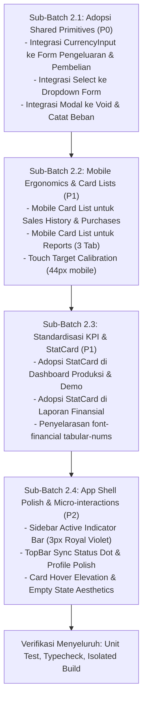

# VeyraOS — Laporan Audit UI/UX & Blueprint Implementasi Batch 2

**Tanggal:** 26 Oktober 2026  
**Status:** Perencanaan Selesai (PLAN MODE — Menunggu Tinjauan & Persetujuan)  
**Tooling:** UI UX Pro Max v2.15.0 CLI (`.agents/skills/ui-ux-pro-max/`)  
**Lingkungan Python:** Python 3.13.2 (Windows standard runtime)  
**Baseline Kode:** 932/932 Unit Test PASS (45 File), Production Build PASS (Exit Code 0)  

---

## 1. Verifikasi Instalasi & Aktivasi Skill UI UX Pro Max

### 1.1 Status Lingkungan & File Skill
- **Lokasi Instruksi:** `.agents/skills/ui-ux-pro-max/SKILL.md` (Terverifikasi Ada).
- **Skrip Eksekusi:** `.agents/skills/ui-ux-pro-max/scripts/search.py` (Standard library Python, tanpa network dependency pihak ketiga).
- **Runtime Python:** Python 3.13.2 terdeteksi aktif pada PATH sistem melalui perintah `py -3`.
- **Hasil Uji Panggilan CLI:**
  - `py -3 .agents/skills/ui-ux-pro-max/scripts/search.py --help`: Berhasil (Exit code 0, 12 domain pencarian aktif).
  - `py -3 .agents/skills/ui-ux-pro-max/scripts/search.py "fintech pos smb retail saas dashboard" --design-system -p "VeyraOS" --format markdown`: Berhasil menghasilkan matriks evaluasi desain.
  - `py -3 .agents/skills/ui-ux-pro-max/scripts/search.py "mobile touch targets accessibility" --domain ux`: Berhasil memuat panduan WCAG 2.5.5 touch target.
  - `py -3 .agents/skills/ui-ux-pro-max/scripts/search.py "responsive layout animation" --stack nextjs`: Berhasil memuat aturan Next.js layout shift & responsive image.
- **Kesimpulan Status:** Skill `ui-ux-pro-max` **AKTIF dan SIAP DIGUNAKAN SECARA PENUH**.

---

## 2. Laporan Audit UI/UX VeyraOS Berdasarkan Kode Aktual

Audit komprehensif dilakukan secara menyeluruh terhadap seluruh modul halaman dan komponen bersama yang ada di `src/`:

### 2.1 Area 1: Landing Page & Mode Demo
- **File Diperiksa:**
  - `src/app/page.tsx` & `src/app/landing-page-view.tsx`
  - `src/app/demo/page.tsx` & `src/app/demo/dashboard/page.tsx`
  - `src/app/demo/sales/page.tsx` & `src/app/demo/sales/new/page.tsx`
  - `src/components/demo/demo-banner.tsx` & `src/components/demo/demo-sidebar.tsx`
- **Temuan Positif:**
  - Landing page memiliki arsitektur visual modern: header sticky dengan backdrop blur, badge identitas "Business & Finance Engine", hero CTA ganda, dan kartu kapabilitas yang terstruktur rapi.
  - Mode Demo memiliki *psychological isolation* yang sangat kuat: banner atas fixed berwarna `#392477` dengan badge kuning `#FFD54F`, tombol reset data lokal, dan menu non-demo yang terkunci secara jujur ("Segera Hadir" dengan ikon gembok).
  - Kasir POS Demo memiliki layout 2-kolom ergonomis dan alur kalkulasi kembalian tunai yang sangat responsif.
- **Kekurangan & Celah Visual:**
  - Dialog detail transaksi dan dialog konfirmasi Void di `demo/sales/page.tsx` serta modal pembayaran di `demo/sales/new/page.tsx` masih dibangun secara manual (*inline modal backdrop div*) dengan backdrop `bg-black/60`, belum menggunakan komponen primitif terstandarisasi `Modal` (`src/components/ui/modal.tsx`).
  - Input nominal uang pada modal pembayaran demo kasir masih menggunakan manipulasi string manual `replace(/\D/g, '')` alih-alih `CurrencyInput`.

### 2.2 Area 2: Dashboard Bisnis Utama
- **File Diperiksa:** `src/app/dashboard/dashboard-content.tsx` & `src/app/dashboard/page.tsx`
- **Temuan Positif:**
  - 6 Kartu KPI Finansial (Net Sales, COGS, Gross Profit, Operating Expenses, Operating Profit, Cash Flow) memiliki struktur semantik yang sangat jelas sesuai akuntansi UMKM.
  - Grafik tren omzet harian native SVG memiliki aksesibilitas tinggi: keyboard navigable, tooltip interaktif, dan tabel ringkasan `sr-only` untuk screen reader.
  - State komprehensif: Shimmer skeleton loading, error alert dengan tombol retry, dan empty state ramah saat bisnis belum memiliki transaksi.
- **Kekurangan & Celah Visual:**
  - 6 Kartu KPI masih dibuat menggunakan perulangan markup `Card` manual dengan kelas styling inline, belum memanfaatkan komponen `StatCard` (`src/components/ui/stat-card.tsx`) yang sudah dilengkapi indikator tren dan `font-financial`.
  - Pada layar smartphone kecil (< 400px), grid KPI `grid-cols-1 sm:grid-cols-2 lg:grid-cols-3` membuat kartu memanjang secara vertikal, butuh visual padding yang lebih padat (*density calibration*).

### 2.3 Area 3: Modul Produk & Pembelian (Restock)
- **File Diperiksa:**
  - `src/app/products/product-list-content.tsx` & `src/app/products/[id]/product-detail-content.tsx`
  - `src/app/purchases/purchases-content.tsx` & `src/app/purchases/new/purchase-form-content.tsx`
- **Temuan Positif:**
  - Daftar produk (`product-list-content.tsx`) telah mengadopsi pola responsif ganda: Desktop Table (`hidden md:block`) dan Mobile Card List (`md:hidden`).
  - Halaman pembelian baru (`purchase-form-content.tsx`) menampilkan kalkulasi Moving Weighted Average Cost (HPP bergerak) secara real-time sebelum transaksi disimpan.
- **Kekurangan & Celah Visual:**
  - Formulir pembelian baru (`purchase-form-content.tsx`) baris 510-525 masih menggunakan tag `<select>` HTML bawaan browser dengan border standar, belum mengadopsi komponen `<Select>` terstandarisasi dengan ikon Chevron kustom VeyraOS.
  - Input harga beli per unit pada baris item restock masih menggunakan `<Input>` dengan `leftIcon="Rp"` dan regex manual, belum menggunakan `<CurrencyInput>`.
  - Tabel riwayat pembelian (`purchases-content.tsx`) masih mengandalkan horizontal scrollbar `overflow-x-auto` di layar mobile, belum memiliki tampilan kartu ringkasan mobile seperti pada modul produk.

### 2.4 Area 4: Modul Penjualan & POS Produksi
- **File Diperiksa:**
  - `src/app/sales/sales-history-content.tsx` & `src/app/sales/new/sales-checkout-content.tsx`
- **Temuan Positif:**
  - Riwayat penjualan memiliki filter tanggal 30 hari, status badge lunas/voided yang tegas, ringkasan transaksi di atas tabel, dan paginasi server.
  - Validasi pembatalan (Void) memiliki validasi alasan minimal 5 karakter dan perlindungan idempotency key persisten.
- **Kekurangan & Celah Visual:**
  - Dialog pembatalan transaksi (`VoidModal` di `sales-history-content.tsx`) dibuat manual menggunakan fixed overlay div, belum menggunakan komponen `Modal`.
  - Tabel riwayat penjualan produksi belum memiliki transformasi *Mobile Card View* di layar smartphone (< 768px). Pengguna ponsel harus melakukan geser horizontal untuk melihat status dan tombol aksi "Batalkan".
  - Tombol aksi "Batalkan" di tabel berukuran tinggi `h-7` (28px), di bawah standar kenyamanan sentuhan jempol mobile (44px).

### 2.5 Area 5: Modul Beban Operasional & Laporan Keuangan
- **File Diperiksa:**
  - `src/app/expenses/expenses-content.tsx` & `src/constants/expenses.ts`
  - `src/app/reports/reports-content.tsx`
- **Temuan Positif:**
  - Pelanggaran warna pelangi kategori beban telah diperbaiki: kategori beban telah dinormalisasi menggunakan palet netral berpadu Royal Violet lembut.
  - Laporan keuangan memiliki 3 tab terpisah (Penjualan, Beban, Stok & Valuasi), filter tanggal draft vs applied, trigger ekspor CSV, dan indikator laba kotor/bersih.
- **Kekurangan & Celah Visual:**
  - Modal "Catat Pengeluaran Baru" (`CreateExpenseModal` di `expenses-content.tsx`) dibuat inline dengan backdrop div, event keydown Escape manual, dan input nominal regex manual.
  - Seluruh 3 tabel utama di modul Laporan (`reports-content.tsx`) masih berupa tabel desktop lebar yang dibungkus `overflow-x-auto`. Di layar smartphone 375px, pengguna mengalami disorientasi membaca kolom-kolom finansial yang lebar.
  - Kartu metrik di atas tab Penjualan dan Beban masih dibuat secara manual tanpa abstraksi `StatCard`.

### 2.6 Area 6: Pengaturan Bisnis (Settings)
- **File Diperiksa:** `src/app/settings/settings-content.tsx`
- **Temuan Positif:**
  - Tata letak formulir profil toko sangat rapi, bersih, dan memuat informasi teknis tenant yang jelas.
  - Konfigurasi regional (IDR dan WIB) ditandai sebagai "Baku Sistem" dengan proteksi read-only yang mengedukasi pengguna.
- **Kekurangan & Celah Visual:**
  - Dropdown kategori bisnis masih menggunakan native select.
  - Transisi tombol simpan perubahan belum memiliki micro-interaction visual yang responsif.

### 2.7 Area 7: Shared Components & Navigasi (App Shell)
- **File Diperiksa:**
  - `src/components/layout/sidebar.tsx`
  - `src/components/layout/top-bar.tsx`
  - `src/components/layout/mobile-nav.tsx`
  - `src/components/layout/app-layout.tsx`
  - `src/components/ui/` (`modal.tsx`, `select.tsx`, `currency-input.tsx`, `stat-card.tsx`, `brand-logo.tsx`, dll.)
- **Temuan Positif:**
  - Seluruh primitif inti Batch 1 (`Modal`, `Select`, `CurrencyInput`, `StatCard`, `formatters`) sudah ada di `src/components/ui/` dan memiliki unit test mandiri yang 100% lulus.
  - Sidebar dan MobileNav memiliki accessibility markup: `aria-current="page"`, `aria-label`, target sentuh dasar `min-h-[44px]`.
- **Kekurangan & Celah Visual:**
  - Navigasi sidebar desktop belum memiliki indikator visual aktif yang tegas (garis aksen vertikal 3-4px di sisi kiri item yang aktif seperti pada software enterprise modern).
  - TopBar belum memiliki indikator status konektivitas / sinkronisasi data yang dinamis.
  - **Isu Kunci Keseluruhan:** Terjadi *gap adopsi* di mana komponen primitif Batch 1 (`Modal`, `Select`, `CurrencyInput`, `StatCard`) belum diintegrasikan ke halaman-halaman operasional aplikasi.

---

## 3. Rekomendasi Design System VeyraOS

Berdasarkan analisis UI UX Pro Max dan identitas brand VeyraOS yang telah disetujui, kami menyusun spesifikasi design system berikut:

### 3.1 Filosofi Desain: "Royal Violet Operational Excellence"
- **Light Mode Default yang Hangat & Elegan:** Menggunakan latar belakang kanvas `#FAF9F6` (Warm Ivory / Paper) yang mengurangi ketegangan mata pedagang yang melihat layar kasir seharian.
- **Aksen Royal Violet yang Wibawa:** `#5B3CC4` sebagai warna brand utama, `#392477` untuk kontainer primer dan penekanan teks, serta `#F6F3FF` untuk surface kontainer sekunder.
- **Restrained Semantic Status (Bukan Pelangi):**
  - **Success / Kas Masuk / Laba:** `#0E6251` (teks) / `#E8F8F0` (latar) / `#1E824C` (ikon)
  - **Warning / Stok Menipis:** `#7D6608` (teks) / `#FEF9E7` (latar) / `#B9770E` (ikon)
  - **Danger / Stok Habis / Void:** `#922B21` (teks) / `#FDEDEC` (latar) / `#C0392B` (ikon)
  - **Info / Panduan:** `#1B4F72` (teks) / `#EBF5FB` (latar) / `#2980B9` (ikon)
- **Demo Mode Isolation:** `#392477` banner + `#FFD54F` badge kontras tinggi.

### 3.2 Tipografi Finansial & Skala
- **Font Sans Utama:** `Plus Jakarta Sans` untuk seluruh heading, label, dan body text.
- **Font Angka Tabular (Monetary):** `JetBrains Mono` yang dipadukan dengan utility class `.font-financial`:
  ```css
  .font-financial {
    font-family: var(--font-mono);
    font-variant-numeric: tabular-nums lining-nums;
    letter-spacing: -0.02em;
  }
  ```
- **Aturan Pemformatan Uang:** Selalu menggunakan format standar Rupiah integer (`Rp 1.500.000`) dengan perataan kanan (`text-right`) pada seluruh kolom tabel data.

### 3.3 Standar Komponen & Target Sentuh (WCAG 2.5.5)
- **Minimum Touch Target:** Seluruh tombol aksi, tab bar, navigasi, dan pilihan dropdown di layar sentuh ponsel wajib memenuhi target sentuh minimal 44×44 px (atau memiliki touch padding setara `min-h-[44px]`).
- **Mobile Card Transformation:** Setiap tabel data yang memiliki lebih dari 4 kolom wajib memiliki alternatif tampilan kartu ringkasan terstruktur (`md:hidden`) untuk kenyamanan penggunaan satu tangan (*one-hand thumb zone*).

---

## 4. Matriks Pemetaan Masalah Berdasarkan Prioritas

| ID | Prioritas | Kategori | Lokasi Berkas | Deskripsi Masalah & Rekomendasi Solusi |
|:---|:---|:---|:---|:---|
| **P0-1** | **P0 (Critical Consistency)** | Komponen Primitif | `expenses-content.tsx`, `purchase-form-content.tsx`, `sales-checkout-content.tsx` | **Adopsi CurrencyInput:** Halaman input uang masih memakai regex manual. Ganti dengan `<CurrencyInput>` terstandarisasi untuk mencegah lompatan kursor dan menjamin format Rupiah konsisten. |
| **P0-2** | **P0 (Critical Consistency)** | Komponen Primitif | `sales-history-content.tsx`, `expenses-content.tsx`, `demo/sales/page.tsx`, `reports-content.tsx` | **Adopsi Modal Bersama:** Dialog Void, Catat Beban, Detail Transaksi, dan Ekspor CSV masih memakai modal inline. Ganti dengan `<Modal>` bersama untuk menjamin trap-focus dan aksesibilitas Escape terpusat. |
| **P0-3** | **P0 (Critical Consistency)** | Komponen Primitif | `purchase-form-content.tsx`, `reports-content.tsx`, `expenses-content.tsx` | **Adopsi Select Kustom:** Ganti elemen `<select>` native dengan komponen `<Select>` VeyraOS dengan panah Chevron kustom violet. |
| **P1-1** | **P1 (Ergonomics & Layout)** | Mobile Responsiveness | `reports-content.tsx` (Tab Penjualan, Beban, Stok) | **Mobile Card List Laporan:** Sediakan alternatif tampilan kartu ringkasan untuk 3 modul laporan di layar mobile (< 768px) guna mengeliminasi scroll horizontal yang melelahkan. |
| **P1-2** | **P1 (Ergonomics & Layout)** | Mobile Responsiveness | `sales-history-content.tsx` & `purchases-content.tsx` | **Mobile Card List Transaksi & Pembelian:** Sediakan card list mobile sejajar dengan implementasi yang sudah ada pada modul produk dan demo sales. |
| **P1-3** | **P1 (Ergonomics & Layout)** | Touch Target | `button.tsx`, tabel aksi di `sales-history-content.tsx`, `purchases-content.tsx` | **Penyempurnaan Target Sentuh:** Kalibrasi tombol berukuran kecil (`size="sm"`) agar memiliki area klik sentuh minimal 44px di perangkat mobile tanpa merusak kepadatan desktop. |
| **P1-4** | **P1 (Ergonomics & Layout)** | Komponen Primitif | `dashboard-content.tsx`, `demo/dashboard/page.tsx`, `reports-content.tsx` | **Adopsi StatCard Finansial:** Standarkan kartu metrik KPI menggunakan `<StatCard>` terpusat dengan tipografi `.font-financial`. |
| **P2-1** | **P2 (Visual Delight)** | App Shell / Navigasi | `src/components/layout/sidebar.tsx` & `demo-sidebar.tsx` | **Active Indicator Aksen Bar:** Tambahkan garis aksen vertikal Royal Violet (3px) di sisi kiri menu aktif dan efek hover yang lebih halus pada sidebar desktop. |
| **P2-2** | **P2 (Visual Delight)** | App Shell / TopBar | `src/components/layout/top-bar.tsx` | **Konektivitas & Profil Popover:** Tambahkan visual indicator dot hijau pulsing lembut untuk status sistem online/tersinkronisasi. |
| **P2-3** | **P2 (Visual Delight)** | Micro-interactions | `card.tsx`, `button.tsx`, `empty-state.tsx` | **Hover Elevation & Empty State Polish:** Berikan transisi elevasi halus pada kartu interaktif (`hover:shadow-sm hover:border-[#5B3CC4]/30`) dan sentuhan ilustrasi halus pada empty state. |

---

## 5. Rencana Implementasi Bertahap: UI Polish Phase 2 Batch 2

Untuk menjaga stabilitas, pengerjaan Batch 2 dibagi menjadi **4 Sub-Batch Terfokus**:



### Sub-Batch 2.1: Adopsi Shared Primitives (Prioritas P0)
- **Sasaran:** Mengganti seluruh modal inline, native select, dan currency input regex manual di modul transaksi, beban, dan pembelian.
- **File Target:**
  - `src/app/expenses/expenses-content.tsx`
  - `src/app/purchases/new/purchase-form-content.tsx`
  - `src/app/sales/sales-history-content.tsx`
  - `src/app/demo/sales/page.tsx`
  - `src/app/demo/sales/new/page.tsx`
- **Output:** Kode bersih, DRY (*Don't Repeat Yourself*), dan konsistensi interaksi modal/form 100%.

### Sub-Batch 2.2: Mobile Ergonomics & Card Lists (Prioritas P1)
- **Sasaran:** Menghilangkan keharusan scroll horizontal tabel pada layar ponsel.
- **File Target:**
  - `src/app/sales/sales-history-content.tsx`
  - `src/app/purchases/purchases-content.tsx`
  - `src/app/reports/reports-content.tsx`
- **Output:** Tampilan mobile card list terstruktur di layar `< 768px` dan tabel desktop tetap padat di `md:block`.

### Sub-Batch 2.3: Standardisasi KPI & StatCard (Prioritas P1)
- **Sasaran:** Menyeragamkan penyajian kartu metrik finansial di seluruh dashboard dan laporan.
- **File Target:**
  - `src/app/dashboard/dashboard-content.tsx`
  - `src/app/demo/dashboard/page.tsx`
  - `src/app/reports/reports-content.tsx`
- **Output:** Tampilan KPI seragam dengan ikon semantik berlatar lembut, angka tabular JetBrains Mono, dan badge tren persentase.

### Sub-Batch 2.4: App Shell Polish & Micro-interactions (Prioritas P2)
- **Sasaran:** Meningkatkan kualitas estetika bingkai aplikasi (*app shell*) dan interaksi sentuh.
- **File Target:**
  - `src/components/layout/sidebar.tsx` & `src/components/demo/demo-sidebar.tsx`
  - `src/components/layout/top-bar.tsx`
  - `src/components/ui/card.tsx` & `src/components/ui/empty-state.tsx`
- **Output:** Tampilan aplikasi kelas enterprise dengan active indicator bar, transisi halus, dan empty state yang menarik.

---

## 6. Strategi Pengujian, Keselamatan Rekayasa & Anti-Regresi

### 6.1 Protokol Keselamatan Rekayasa Mutlak
1. **Preservasi Logika Bisnis:**
   - Tidak ada perubahan formula matematika finansial (integer IDR), logika moving average cost, maupun flow server action.
   - Seluruh pembaruan strictly beroperasi pada lapisan presentasi JSX dan styling CSS/Tailwind.
2. **Proteksi Git Staging:**
   - Berkas staged pengguna `docs/stage-5.6-step-2-implementation-report.md` tetap dipertahankan utuh dan tidak boleh disentuh.
3. **Proteksi Dev Server:**
   - Dev server aktif pada port 3000 tidak boleh dimatikan atau di-restart.
4. **Validasi Berkala per Sub-Batch:**
   - Menjalankan `npm test` setelah setiap sub-batch untuk memastikan 932 unit test tetap 100% PASS.
   - Menjalankan `npm run type-check` (`tsc --noEmit`) untuk memastikan 0 error tipe TypeScript.
   - Verifikasi production build terisolasi pada checkpoint akhir sebelum penutupan batch.
5. **Penanganan Keamanan Next.js:**
   - Rekomendasi upgrade keamanan Next.js dari vendor dicatat sebagai pekerjaan terpisah yang dijadwalkan setelah batch UI polish selesai agar tidak menimbulkan distorsi pada dependensi aktif saat ini.
